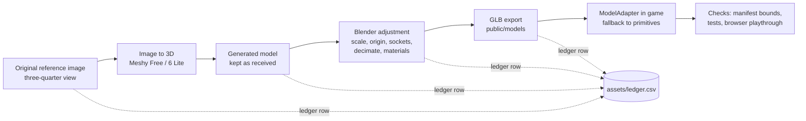

# Design Document

## Overview

This design defines how final assets are produced and how they replace the placeholder primitives without touching the game logic. It has four parts:

1. The production pipeline per asset, with file layout and the ledger that links every stage.
2. Dimensions, sockets, and budgets, with the reason for each provisional value.
3. A view-layer `ModelAdapter` that loads GLBs and falls back to primitives.
4. The Costume Contest presentation proposal, kept separate and unadopted.

**Status (2026-11-20):** asset production and branch integration are in progress. Codex generated original reference images with OpenAI and, with the user's explicit authorization, registered for Meshy Free and generated/downloaded Duck, hat, Child, and Adult with Meshy 6 Lite. Duck and hat have completed Blender adjustment, export, reimport, and independent review. Child and Adult clothed/bath variants have also been exported, reimported and measured. The initial human models are static meshes; a shared skeleton and animation remain open. The per-file production status and measured dimensions are recorded in `assets/ledger.csv` and `assets/manifest.json`. Game integration and normal-input playthrough are separate checks tracked by the shoulder-view Spec and `docs/crew-pilot.md`; main still renders primitives. Code is MIT; Meshy-generated and modified 3D assets are CC BY 4.0. Planned limits below remain provisional unless supported by recorded measurements.

## Pipeline



### Per-stage rules

| Stage | What is done | Kept as evidence |
| --- | --- | --- |
| Reference image | Start with one clear three-quarter PNG of an original design, 1024–2048 px, with transparent background. Add matching front/side/back views when reconstruction needs them. The initial four references use OpenAI image generation; prompts, revisions, rights and exact hashes are recorded per asset. | Images, method, input rights |
| Image to 3D | Generate from the reference image. Keep the raw output untouched. Several attempts are allowed; the ledger records the chosen one. | Raw output, service, version or date, terms link, settings |
| Blender adjustment | Import; fix broken geometry; set scale (meters), +Y up / +Z front on export, origin at bottom center; add sockets; split parts (e.g. hat removed from Duck if the generator merged them); decimate to budget; bake or resize textures; name materials. | `.blend` file, Blender version, notes on changes |
| GLB export | glTF 2.0 binary, embedded textures, no cameras or lights, Y-up. Apply transforms. | GLB, checksum, measured bounds in the manifest |
| Game integration | Load through `ModelAdapter`, compare with the manifest, run tests and a browser playthrough. | Test results, who did the playthrough |

Derivation: an asset may be cut or edited from another asset's generated model or `.blend` (for example, wall variants from one generated wall). *(Provisional: the user did not specify whether every asset needs its own generation.)* A derived asset still has the full pipeline, inherited from its parent:

| Derived asset's ledger | Required content |
| --- | --- |
| `reference` row | `parent_asset` = parent AssetID; `file` and `sha256` of the parent's existing `done` reference image; `notes` = "inherited" |
| `generated` row | Same, pointing to the parent's existing `done` generated model |
| `blend` row | The derived asset's own `.blend`, or the named object inside the parent's `.blend` (object name in `notes`), with its own checksum |
| `final` row | The derived asset's own GLB |

A row may not say "not applicable" to skip a stage of a final asset. Only `prototype` rows, which are never final, may use it. An asset whose inherited rows point to a missing file or a parent stage that is not `done` cannot be marked `final`.

### Production order

| Stage | Assets | Purpose |
| --- | --- | --- |
| 2 (confirmed order) | `duck` → `hat_sauna_duck` → bath section kit (`bath_wall_2m`, `bath_wall_narrow_hole`, `bath_door_frame`, `bath_tub`, `bath_kakeyu`, `soap`, `coin_500`) | Fix the art style from Duck's viewpoint; check hat on/off and the scale against the bath |
| 3 | `child`, `adult` (each with `clothed` and `bath` outfits), `towel`, `sauna_key`, reception, changing room, sauna and crowd, open-air bath, pond | Extend the fixed style |

The table is the initial production order. The user's later correction prioritizes three actual 3D characters and an over-the-shoulder view, so human production now proceeds before the environment kit is complete. This does not mark the kit or stage-2 playthrough done. The initial provisional style uses rounded matte toy forms: yellow/orange Duck, pale aqua felt hat, coral/navy Child and teal/charcoal Adult. Human colors are baked in Blender into embedded textures up to 1024 px; Duck uses vertex colors and the hat one material. These are implementation choices, not a user-approved final art direction. A complete environment style record and scene-performance measurements remain open.

### Image to 3D service selection

Selected: **Meshy Free / Meshy 6 Lite / Texture off**, after checking current official terms and download conditions on 2026-11-20. The user explicitly authorized free registration, terms acceptance, original-image upload and generation, including the disclosed training use. All four initial meshes were downloaded within the free allowance. No paid plan, credit purchase or Community publication was used. See `assets/service-selection.md` for links and the record answering these questions:

1. Who owns the outputs, and under what license.
2. Whether outputs may be published in a public open-source repository and redistributed in a public web build.
3. Commercial use (for safety, even though the hackathon entry is not sold).
4. Whether uploaded images are kept, shared, or used for training, and whether that can be turned off.
5. Plan or credit requirements. **No paid plan or new purchase is assumed**; one needs the user's explicit approval.
6. Export formats (GLB preferred), texture output, and polygon controls.

If the terms do not allow public redistribution, the asset cannot enter the public build (Requirement 7.2).

### Authorization and reference method

**Adopted provisional reference method.** Codex uses original OpenAI-generated three-quarter references with no third-party character or photograph input. Human images were refined once to simplify clothing and separate limbs. Multi-view guide sheets were not made and are not reported as completed. Blender measurements and renders check the resulting silhouette against the dimensions and sockets below. The exact prompts and hashes are in each `assets/<id>/ref/README.md`.

**Asset rights.** The project releases its rights to original reference images under MIT, to the extent permitted by law. Meshy free-plan outputs and their Blender modifications retain CC BY 4.0 attribution, the license link, and modification descriptions. The approved workflow is sufficient for these initial assets; a new paid service or purchase is outside that authorization.

| Can proceed within existing authorization | Needs approval if not already authorized |
| --- | --- |
| Design briefs and silhouette guide sheets (local SVG or a Blender script) | Creating an account on any image or Image to 3D service, or connecting one |
| Reading the public terms, pricing, and documentation pages; recording findings in this design | Any payment, plan, credit purchase, or trial that needs a payment method |
| A service comparison, provisional method selection, and a rights-based asset license policy | Uploading images or other data to an external service outside existing authorization |
| Ledger rows for the guide sheets (`stage = reference`, `status = in_progress`; a guide is not the finished reference image) | Granting new permissions or app access to a service |
| ModelAdapter code tested with a locally made test GLB, marked as a test fixture | Release under a license or commitment outside existing authorization |

Existing authorization remains valid; do not ask for it again. Ordinary method and preparation decisions are provisional design decisions, not approval gates. Before publishing any generated output, complete its redistribution and rights checks. User approval does not substitute for those checks.

A test GLB made by a Blender script is a **fixture**, not a final asset. It lives under `tests/fixtures/`, gets no `final` ledger row, and never replaces a pipeline stage.

## Dimensions and colliders

The logic is unchanged. Visual models must look consistent with these logic values (from `src/level/layout.ts`):

| Element | Logic value | Visual rule (provisional) | Reason |
| --- | --- | --- | --- |
| Duck collider | r 0.15 m (width 0.30) | Height 0.28–0.32 m; max width ≤ 0.36 m | Prototype body height is 0.30 m. 0.36 m leaves 0.02 m per side inside the 0.40 m hole, so Duck visibly fits. |
| Child collider | r 0.25 m (width 0.50) | Height 1.15–1.25 m; shoulders 0.44–0.56 m | Prototype height 1.2 m. Shoulders ≤ 0.56 m stay inside the 0.60 m gap; ≥ 0.44 m keep the body wider than the 0.40 m hole. The height is a gameplay scale, not a claim about a specific age (the child's age is undecided). |
| Adult collider | r 0.35 m (width 0.70) | Height 1.65–1.75 m; shoulders 0.64–0.80 m | Prototype height 1.7 m. Shoulders ≥ 0.64 m are visibly wider than the 0.60 m gap. |
| NarrowHole | 0.40 m clear | Rim mesh must not narrow the clear opening; visual opening 0.40–0.45 m | A visually narrower rim than the logic opening would look like Duck clips through the wall. |
| CrowdGap | 0.60 m clear ×3 | Seated crowd figures (stage 3) keep the same clear gaps | Same reason |
| Door | 1.20 m clear | Frame interior 1.20–1.25 m | Same reason |
| Walls | thickness 0.2 m, collision only | Visual height 1.0–1.2 m (diorama cutaway) | The current follow cameras (eye heights 0.75–4.2 m) and the overview look over 1.0 m walls. Full-height walls would hide the active character unless a cutaway system is added. Revisit after the stage-2 style record. **Open (2026-11-20):** the shoulder view (`.kiro/specs/shoulder-view`) uses 2.6 m walls with ceilings and keeps the cutaway only for the overview; the wall kit needs that height or a modular upper part. |

Export convention for every GLB: meters, +Y up, front +Z, origin at the bottom center of the footprint.

The view model gives mesh **centers**, and the adapter places each GLB root at the bottom. With the prototype values (`deriveView`), Duck's radius is 0.15 m, so its body is 0.30 m tall:

| Case | Center Y in `deriveView` | Root (bottom) Y used by the adapter | Rule |
| --- | --- | --- | --- |
| Human | `height / 2` (Child 0.60, Adult 0.85) | 0.00 | `rootY = centerY − height / 2` |
| Duck on tub/channel water | 0.15 | 0.00 | `rootY = centerY − radius`; no independent land movement |
| Duck in the pond | 0.10 | −0.05 (bottom 5 cm below the water surface at Y = 0) | `rootY = centerY − radius` (the same rule; no separate waterline offset) |
| Duck carried | 1.05 | 0.90 | Root parented to Adult's `socket_carry` at 0.90 m |

One rule (`rootY = centerY − radius`) covers Duck in every case, so the final model sits where the prototype sphere sits: partly submerged in the shallow drawn tub/channel water, slightly sunk in the pond, and at the carry anchor while held. Since the water-only movement correction, Duck does not have an independent land state. The numeric entries above retain the prototype placement convention; the integrated carried model follows Adult's actual `socket_carry`.

### Sockets

| Socket | In asset | Position (provisional, model space) | Use |
| --- | --- | --- | --- |
| `socket_hat` | `duck` | Top of head, about (0, 0.28, 0.03) | Hat attached while `hatAttachedToDuck` is true. Prototype draws the hat 0.06 m above the top of the duck. |
| `socket_carry` | `adult` | Chest front, about (0, 0.90, 0.22) | The carried Duck's **root (bottom-center origin)** is attached here. Root at 0.90 m + radius 0.15 m puts Duck's center at 1.05 m, the same as the prototype's carried sphere. Logic keeps `duck.pos = adult.pos`. |
| `socket_hand_r` | `child`, `adult` | Right hand at rest | Coin, key, hat while held. Replaces the prototype's "above the head" marker. |
| `socket_label` | all characters | Above the head | Name label anchor; label sizing stays 12–22 px. |

Hat GLB origin: center of the inner base, so attaching it to `socket_hat` needs no extra offset. Hat size: base diameter 0.16–0.22 m, height 0.12–0.18 m. Prototype cone: 0.26 m diameter, 0.16 m high. That cone is wider than Duck's head (0.30 m body with a smaller head), so the final hat is narrower.

### Characters, rig, outfits

- **Duck**: no skeleton. Motion from whole-model bob, tilt, and yaw as in `KIRO_HANDOFF.md`.
- **Child and Adult** (stage 3): shared bone names and hierarchy, at most 40 bones. Shared clips: idle, walk, run, hold, dry, carry. Retarget by bone name.
- **Bathing representation** (`KIRO_HANDOFF.md` leaves this to the design stage): two body variants per human on the same skeleton. The renderer picks the variant from `ClothingState`, and logic is unchanged. *(Provisional; chosen for a child-friendly public demo.)*
  - `clothed`: everyday clothes.
  - `bath`: an abstract toy-figure body, like a wooden kokeshi or a capsule doll. It has a smooth, single-color body with no anatomical detail and **no towel on the body**, so no towel ever touches the bathwater. That would contradict F1, because towels must not go in the bath.
  - In bathwater and splash zones a soft steam layer at water level covers the body from the waist down. The follow cameras keep their current angle above the character, which reads as natural framing rather than censorship.
  - The towel is the separate `towel` model. While a human is in the bathwater it is drawn folded on the human's head or on the tub edge, never in the water. It sits in the hand only outside the water, for drying (T). *(Update 2026-11-20: T was removed; drying is E at the bath-side exits, and the towel can be moved between hand and head with E. The prototype draws a provisional towel box on the head, or hanging from the hand socket with its bottom above the drawn water surface; see shoulder-view Req 7.6.)*

## Budgets

### Washing-station finishing batch (2026-11-21)

At the user's request, normal-input play is deferred while finishing work proceeds. The first environment batch is the five washing stations' stools and basins. The original paired reference is retained as provenance, but production now uses separate single-object references for the ivory stool and yellow open basin. Initial Meshy 6 Lite generations were started separately. The production workflow requires Blender adjustment of each actual generated model for its own export. Each asset retains its own reference, unmodified generated file and checksums. This supersedes the plan to generate a combined kit and separate it in Blender. This is a partial bath-section kit, not completion of all facilities.

Both separate Meshy 6 Lite generations completed and their untextured GLBs were downloaded. The stool preview reported 87,590 triangles / 43,795 vertices; the basin reported 97,848 triangles / 48,926 vertices. Each cost 10 free credits under CC BY 4.0. The user chose free Blender correction after the higher-quality model's subscription requirement was explained. No higher-model generation or paid subscription was purchased. Blender correction, export, reimported measurements and multi-angle asset checks are complete for these two assets. Their runtime URLs are registered in the local finishing branch; independent review and the deferred game-view checks remain pending.

Visual replacement uses the existing `LEVEL.fixtures` stool boxes (0.36 × 0.36 m footprint, 0.30 m height) and `LEVEL.decor` bucket boxes (0.20 × 0.18 m footprint, 0.14 m height, bottom at 0.50 m). Colliders, routes, camera obstacles, gameplay state and placement coordinates remain authoritative in LEVEL. Roots are bottom-centered with +Y up, and five instances share each asset's geometry/material. Missing or invalid models keep the primitive. Per-instance transforms fit the existing envelopes; assets must not cover labels or change movement.

The first v01 exports used 3,000 stool triangles and 1,920 basin triangles, one material each and no textures. Five pairs totaled 24,600 triangles; the two GLBs totaled 91,744 bytes. The user subsequently rejected their visual quality. These counts and successful topology checks did not establish acceptable shape quality. The v01 GLBs remain archived beside their Blender scenes for reproducible comparison.

### Shape-quality gate (2026-11-21 user feedback)

The user reported poor Duck eye geometry. A clean reference image or successful mesh export is insufficient. Inspect the reimported export at front, both three-quarter views, side/back and a close-up of important features before registering a model for runtime use. Check silhouette, intended bilateral alignment, smooth contour and shading, floating/intersecting parts, and preservation of holes and hollow interiors. For stools inspect all feet, seat and clearance underneath; for basins inspect the entire rim, inner wall, bottom thickness and underside. Keep a reference/raw/adjusted comparison. Repair a bad reconstruction in Blender or regenerate it; do not mark it done merely because it meets size or triangle limits.

The Duck v02 local correction retains the original generated body, removes irregular eye coloring, smooths only the old eye patches and adds a matched pair of smooth eye inserts. The provisional Duck triangle budget increases from 6,000 to 8,000 to preserve facial contours without decimating the body again; one material and no textures remain the target. Hat/label sockets, metric scale and body extents must match v01. This is a local Blender modification of the existing Image-to-3D asset, not a newly generated model. Asset renders do not constitute normal-input gameplay or user acceptance.

### Repeatable correction and visual comparison

The user's second quality report exposed two process defects: preserving the generated source too literally retained bad surface features, while forcing an arbitrary bounding box distorted the basin. Its measured source height/diameter ratio is about 0.452; stretching it to 0.14 m high at 0.20 m wide changed that ratio to 0.70. Runtime placement now uses one uniform scale inside the existing LEVEL envelope and aligns the bottom. The envelope is a containment boundary, not a shape target. Collision and gameplay data remain unchanged.

For each revision:

1. Preserve the unmodified generated input and the previous GLB. Name the visible defects before editing: silhouette, important openings, local curvature and material response.
2. Build a source-derived editable control mesh. Place loops around the drain, rim, arch and foot contacts; use subdivision for continuous curves. Keep an evaluated high-detail master separate from the export. Do not repeatedly smooth the entire object or force a triangle count with unreviewed collapse.
3. Reduce low-curvature regions first, retaining samples at silhouette and curvature changes. Compare the export with the clean master; source-distance measurements describe geometry changes, not reference-image accuracy.
4. Reimport the actual exported GLB. Use `scripts/compare-asset-quality.py` for before/after beauty, neutral clay, silhouette and grazing-reflection views from five fixed directions. The camera, lights, framing, exposure and uniform containment are identical for both versions. Save hashes, conditions, images and the comparison HTML. PNG text metadata is removed without changing pixels.
5. Inspect the views and receive a separate material critique. Correct visible dents, pinching, broken highlight flow or missing openings even when numeric checks pass. Record retained limitations. A diagnostic metal-like reflection pass is deliberately harsher than the intended satin plastic.
6. Check actual GLB bounds, openings, finite geometry, provenance and total scene geometry before promotion. The scene-budget test constructs the real GameScene and counts all visible geometry without frustum culling, including five repeated pairs and the active human outfits. This is an offline geometry bound; it does not measure FPS, actual GPU draw calls or normal-input gameplay.

The reusable method follows Blender's reference/result comparison practice and feature-preserving surface modeling; sources and limitations are collected in `reports/Blender 素材品質 改善実験.md`. A plugin installation itself is not a quality improvement. The existing Blender Python and render tools can perform this loop without a paid service. Final in-game appearance and Crew B's code review remain separate checks.

The selected v02 exports contain 4,610 stool triangles and 2,816 basin triangles, one material and no texture each, totaling 136,996 bytes. Five pairs contain 37,130 triangles. Counting the actual scene with either outfit for each human gives 59,576 visible triangles before frustum culling. The partial bath-kit allocation is revised from 25,000 to 37,500 based on the actual exclusive-outfit geometry, while the required whole-scene limit remains 60,000. New facilities cannot simply consume another allocation; reduction or LOD work must keep the same global limit. Close-up low-poly contour differences and reference-lighting differences are documented, not hidden by successful topology checks.

The game is a browser demo that judges open from a URL on unknown machines. Image to 3D output is often much denser than a game needs, so Blender reduction is planned for every asset. All values are provisional starting points, not measurements.

| Asset | Triangles | Materials | Textures | GLB size |
| --- | --- | --- | --- | --- |
| `duck` | ≤ 8,000 (v02 eye refinement) | 1 | base color 1024², optional normal 1024² | ≤ 1.5 MB |
| `hat_sauna_duck` | ≤ 1,500 | 1 | base color 512² | ≤ 0.3 MB |
| small items (`coin_500`, `sauna_key`, `soap`, `towel`) | ≤ 500 each | share 1 | shared 512² atlas | ≤ 0.2 MB each |
| bath section kit (all pieces) | ≤ 37,500 drawn (reallocated after v02 count) | ≤ 4 | ≤ 4 × 1024² | ≤ 5 MB total |
| `child`, `adult` (both outfits) | ≤ 12,000 each | ≤ 2 | 1024² per outfit | ≤ 3 MB each |
| each later facility kit | ≤ 25,000 drawn | ≤ 4 | ≤ 4 × 1024² | ≤ 5 MB |

Reasons:

- Duck is close to the camera in the low view, so it needs a smooth silhouette. 6,000 triangles is enough for a toy-like duck, and it is small next to the scene budget.
- Scene: 60,000 triangles and 120 draw calls. The earlier 35k/59k planning estimate is superseded by the v02 offline all-visible count of 59,576 triangles, including the actual human outfits and five washing stations. Real GPU draw calls and frame time still require final verification.
- Download: stage 2 is about 7.6 MB against a 12 MB limit. The full set is limited to 30 MB, so the first load stays short on ordinary connections.
- No mesh or texture compression at first, so no extra decoder is needed. If the size limits are exceeded, consider meshopt or KTX2 through a tool such as glTF-Transform. Record that tool and its license before using it.
- Frame rate: target 60 fps at 1280 × 720 on a reference machine. **No reference machine has been chosen yet.** The progress record will name it at the first measurement.

## File layout and ledger

```
assets/
  README.md              how to fill the ledger and manifest
  ledger.csv             one row per asset per stage
  manifest.json          planned limits and measured bounds per asset
  <asset_id>/
    ref/<asset_id>__ref_<view>.png
    gen/<asset_id>__gen_<nn>.<ext>        only if redistribution is allowed
    blend/<asset_id>__v<nn>.blend
public/models/<asset_id>.glb              the only files the game loads
.private/assets/<asset_id>/...            non-redistributable copies (gitignored)
```

- `.private/` is already in `.gitignore` and skipped by `scripts/check-publication.py`. A ledger row for a private file records only the relative path, the checksum, and a description.
- Repository: the project is a public GitHub repository under MIT with `origin/main`, so every file committed under `assets/` and `public/models/` becomes public. That is why the redistribution check comes before the commit, not before the release. The repository's MIT license does not by itself cover generated or third-party asset content (Requirement 7.6).
- Large binaries: whether `.blend` and raw outputs go through Git LFS is open. GitHub rejects single files over 100 MB, and LFS has storage quotas. Provisional rule: commit nothing over 50 MB until this is decided; keep larger files in `.private/` with a checksum in the ledger.
- The checksum is SHA-256 of the exact file, so each stage can be matched to the next.

Ledger columns (`assets/ledger.csv`):

`asset_id, stage, file, status, creator, method, tool_or_service, tool_version, source_type, terms_url, input_rights, output_license, redistributable, commercial_use, attribution, parent_asset, sha256, created_date, notes`

- `stage`: `prototype`, `reference`, `generated`, `blend`, `final`.
- `status`: `planned`, `in_progress`, `done`, `rejected`.
- `redistributable`: `yes`, `no`, `unknown`. Only `yes` may enter `public/models/` (Requirement 7.2).

## ModelAdapter (view layer)

Planned for implementation after the first GLB exists. Nothing in `src/core`, `src/sim`, or `src/level` changes.

```ts
// src/view/models.ts (planned)
interface LoadedModel { root: THREE.Object3D; sockets: Partial<Record<SocketName, THREE.Object3D>> }
class ModelLibrary {
  load(id: AssetId, url: string): Promise<void>;   // GLTFLoader from three/addons
  get(id: AssetId): LoadedModel | null;            // null → caller uses the primitive
}
```

- `GameScene` keeps building primitives. When a model is available it hides the primitive and shows the model at the same position. A load error leaves the primitive in place and logs a warning (Requirement 9.4).
- Characters: placed at the view model position with the foot offset above. Facing comes from the movement direction between frames (view-only state).
- Hat: parented to Duck's `socket_hat` while `hatAttachedToDuck`, to the holder's `socket_hand_r` while held, otherwise placed at `items.hat.pos`.
- Carried Duck: Duck's root (bottom origin) parented to Adult's `socket_carry` while `characters.duck.carried`.
- Body variants: `clothed` or `bath` visible according to the human's `ClothingState`. The towel model is placed outside the water as described above.
- Manifest check (planned test): read `assets/manifest.json`, and for each asset with measured bounds assert the limits in the dimensions table. This test does not need WebGL.

## Readability in both cameras

| Concern | Rule (provisional) | Check |
| --- | --- | --- |
| NarrowHole from Duck's view | Light rim or darker inside so the opening reads against the wall | Screenshot at the hole approach in the DuckView |
| Characters in the overview | Distinct silhouettes (round Duck, short Child, tall Adult); clothing colors are yellow Duck, coral/navy Child and teal/charcoal Adult. Bath variants rely on height/silhouette and labels. | Overview screenshot at 1280 × 720 without labels |
| Duck and hat on water | Saturated yellow Duck and pale aqua hat against desaturated water; check that the hat's rim remains distinguishable | Screenshots in the bathwater and the pond |
| Small items | Coin gold, key silver, soap white with a dark outline or shadow | Both cameras |
| Labels | Keep `src/view/labels.ts` (12–22 px, active label hidden) | Existing `tests/labels.test.ts` |

## Costume Contest presentation (proposal, not adopted)

Source: `docs/kiroween-review.md` proposes a night version of the fictional sento, with steam spirits (湯気の妖怪), lanterns that show what to do, and soft light in the secret pond. It notes that the Costume Contest asks for a spooky UI that supports the function. A plain 3D sento does not meet that. This section turns the idea into a concrete list. **The user has not adopted it.** It changes no confirmed rule.

| Effect (proposal) | Driven by existing data | Supports | Notes |
| --- | --- | --- | --- |
| A small steam spirit follows the active character. When the character is wet and walks toward the changing-room or sauna door, the spirit holds up a towel (drying key: E since 2026-11-20). | `wet`, next area, `entryViolation` preview | F2, F5 | The same check as the pair-door rule, run as a preview. No new rule. |
| Lanterns along the route light toward the current objective's door or object. | `objective()` stage | Guidance from the 500-yen coin search onward | Replaces part of the text guide visually. The text stays. |
| The lantern at a pair door glows when both humans are within 3 m and dims otherwise. | `JOIN_RADIUS`, positions | Parent-and-child accompaniment | Explains the existing door block before it happens. |
| The spirit shivers and the floor ripples when the player holds Shift near the soap. | `run` input, distance to soap | F3 | Warning only. |
| A towel icon with a steam ring appears above the active human standing in the bathwater. | zone `bathwater` | F1 | Warning only. |
| The lantern at the reception door shows a clothes icon while the active human is unclothed. | `clothing`, zone `changing` | F4 | Warning only. |
| In the sauna the lanterns dim, the spirit makes a quiet gesture, and the crowd gaps glow faintly only while Child is active. | zone, `active` | F6, F7 (shows the no-push path) | Matches the existing Child-only gaps. |
| Glowing flow lines show the pond current, and a soft light marks the goal. | `POND.current`, goal zone | Pond navigation, step 10 | |
| On the game-over screen the spirit appears beside the existing reason and manner text. | `VIOLATION_TEXT` | Learning from failure | Text unchanged. |

Constraints if adopted:

- No jump scares, gore, or sudden loud sounds. The tone is gentle and suits children.
- A "reduce effects" option turns off flicker, particles, and camera shake.
- Effects come from a pure function `deriveCues(state, level)` that only reads state. It can be unit-tested, and it cannot change outcomes.
- Built with lights, sprites, particles, and shaders, separate from the model pipeline. If the spirit gets a 3D model, that model goes through the same pipeline and ledger.
- The text says that rules and the fee belong to this fictional facility, as now.

Why it fits: each effect makes an existing rule or route step easier to notice. The spooky elements (night, spirits, lanterns) therefore serve the gameplay, which is the point the review highlights for the Costume Contest. Whether the category is entered is the user's decision, and the official category text must be rechecked before submission.

## Testing and verification

- Manifest bounds test (planned, Requirement 3.6). It runs without WebGL.
- Existing suites unchanged: route, F1–F7, pair doors, checkpoints, input, view, labels (Requirement 9.2).
- A browser playthrough per stage, recording who performed it (Requirement 9.5).
- Publication check before and after each change. Before release, also review the ledger rights columns, `THIRD_PARTY_NOTICES.md`, and the GLB metadata. The scanner does not inspect binaries.
