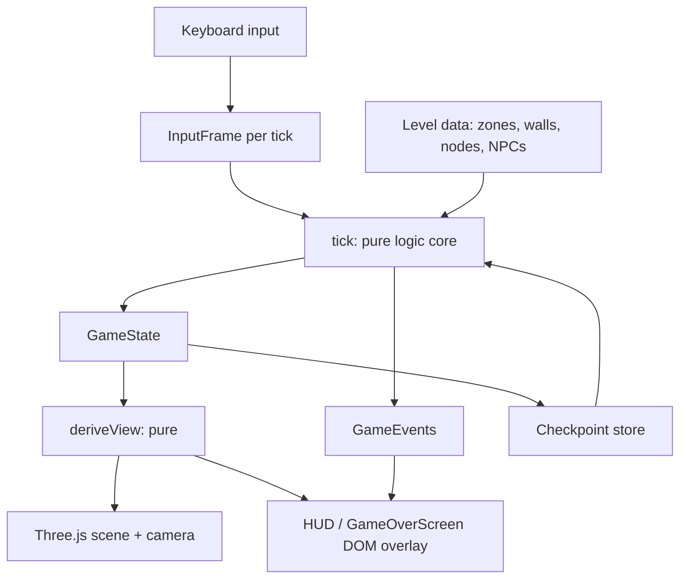

# Design Document

## Growth and exit (2026-11-21, current; provisional geometry)

**This section supersedes, for current behavior, the character switching, item transfers, carrying, payment/key/hat chain, pair doors, the 10-step route, the pond goal and the four checkpoints described earlier in this design. The earlier sections stay as the record of the versions they describe.**

User request (2026-11-21): 「アヒルと子供と大人を切り替えるのではなく最初はアヒル、子供、大人とだんだんキャラが成長していく形」「各ポイントの牛乳瓶を取って成長」「銭湯から出たらクリア」; then 「対応を開始してほしい／kiroを使うようになってるよね？」. Decided by the user: one player who grows Duck → Child → Adult by taking milk bottles, and clears by leaving the sento. Everything else below (two bottles, E, positions, sizes, guardian, high handles, checkpoint points) is a provisional design adopted by Kiro.

### Player and stages

| Item | Contract |
| --- | --- |
| Player | One entity `CoreState.player` with `stage` (`duck` / `child` / `adult`), `pos`, `vel`, `zone`, `wet`, `clothing`, `towel`. No Tab, no inactive bodies, no transfers, no carrying, no reverse growth |
| Collider | Stage radius as before: Duck 0.15, Child 0.25, Adult 0.35 (pass widths 0.30 / 0.50 / 0.70) |
| Duck | Moves only on `LEVEL.duckWater` (`stepDuckWater`), always wet, no clothing, `towel: "none"`. Never walks on floor |
| Child / Adult | Walk and run on land; wetness, clothing, towel and F1–F8 apply as before to the one player |
| Milk bottles | Two unique bottles `milk1` (Duck → Child) and `milk2` (Child → Adult) at `LEVEL.nodes`. E within `REACH.milk` 0.6 m, with a clear straight line (no wall or fixture between), picks one up and grows the player at once. The wrong stage, a second pickup or out-of-order pickup is refused with a hint |
| Growth (atomic, one tick) | Mark the bottle collected, set the next stage, keep position when the new collider fits there, else move to `LEVEL.growthSpots[milk]` (a checked safe spot); keep facing (view); reset velocity. Duck → Child: `wet`, `unclothed`, `towel: "head"`. Child → Adult: keep wetness, clothing and towel. No movement that tick, no entry rules from growth, then the checkpoint |

### Route (coordinates in meters, bath hall west part)

```
x:  0   0.7      2.3 2.5      4.6
z=2.8 +--+GATE+--+                  GATE = high-latch gate x 0.6–1.6 (Adult opens with E)
      | 広い休憩所 |  milk2 (1.7,3.5)
z=4.5 |  +--------+  storage block (0.7,4.5)–(2.3,6.7) h 1.2
      |P |########|  P = child passage x 0.1–0.7 (clear 0.6)
z=6.7 |  +--------+
      | 湯だまり   |  milk1 (1.2,7.05); pool (0.3,7.3)–(2.1,8.7)
z=8.3 |        ~~~|~~~~~~~~~~~~~ trough (−0.1,8.3)–(4.7,8.7) joined to the tub
z=8.9 +-----------+curb              Duck-only gap 0.4 between partition end and curb
          partition x 2.3–2.5, z 2.8–8.3 (h 1.2)        tub (4.6,5.4)–(10.6,8.8)
```

| Step | Stage | Path and clearance |
| --- | --- | --- |
| 1 | Duck | Start in the tub (6.0, 6.8). Swim west along the trough (0.40 m wide, now joined to the tub) through the 0.40 m gap between the partition end and the curb into the shallow pool of the 湯だまり. E at milk1 |
| 2 | Child | 湯だまり (2.2 × 2.2 m) fits the 0.50 m Child. Its only exit for Child is the child passage (0.60 m clear, 2.2 m long) to the 広い休憩所; the trough gap (0.40 m) and the hole (0.40 m) do not fit Child. E at milk2 |
| 3 | Adult | 広い休憩所 (2.2 × 1.5 m) fits the 0.70 m Adult; the passage (0.60 m) does not, so Adult leaves by the separate 1.0 m gate with a high latch (E, Adult only). Then dry on the mat (E), enter the changing room, dress at the locker (E), go round the privacy screen to reception |
| 4 | Adult | Reception → genkan through the ordinary open doorway (x 8). The street door of the genkan (x 11, z −7.6 to −6.4; review R-1, 2026-11-22) has a high handle at 1.6 m (`LEVEL.highDoors.frontExit`, handle (10.9, −7.0)). E opens it for Adult only; Duck/Child get the hint 「取っ手が高くて届かない（大人になったら開けられる）」. A flush threshold stone marks the line. Clear when the player crosses from `genkan` into `street` (zone (11, −9)–(13, −5), 「外」, a 2 m street stub with a low fence) |

- Clear needs the Adult stage and that boundary crossing (the drawn street door, the zone edge and the clear line are the same line x = 11). Reception, the genkan, the sauna, open air, garden and pond never clear. The zone formerly called `exterior` is `genkan`. A failure on the same tick wins over clear. The cleared state is frozen; R (view layer) starts a new game.
- Retired from required progress: coin, payment, key, hat, carrying, transfer dialogs, the pond goal and Duck's pond physics. The coin hole, hat shelf and pond remain as scenery; humans may explore the sauna, open air and garden. The sauna door is never locked: in this fictional facility the sauna is included in the bath admission (not a claim about real sento).
- New fixtures (partition, storage block, curb, gate, street door, handles, street fences, threshold) are provisional shapes drawn over the authored environment; they are not final assets. The environment re-export follows the dynamic door contract: optional root children `growth_kids_gate` / `growth_front_exit` (identity transform, world coordinates, hidden while open) with `_upper` children hidden in the Overview; fixed frames and growth fixtures in `environment_static` / `environment_upper`. The loader accepts both door nodes or neither; with them it hides the game's own growth primitives. The growth_v02 export (2026-11-22, 9,907 architecture triangles) follows this contract: doors under the `sento_environment` root node, fixed growth geometry in `growth_fixed_static` / `growth_fixed_upper` inside the static / upper parts; the layout hash matches again. The game primitives remain only as the load-failure fallback.

### Guardian (non-player)

A scripted adult NPC 「見守りの大人」 watches the Child from the bath hall, outside the kids' corner. It is drawn with the existing standing-bather model `npc_bath_standing.glb` (reused unchanged, bottom-center origin, 1.6 m); the capsule remains the fallback. It walks (Adult speed and radius, wall collision) along a fixed chain of checked dry-floor spots and never enters water, the kids' corner, the passage or the women's entrance. It does not block the player and has no inventory, switching, drying or distance rule.

| Player | Guardian target |
| --- | --- |
| Duck, or Child in the 湯だまり | `pool` (3.1, 7.6), beside the pool |
| Child in the passage or 広い休憩所 | `room` (3.1, 3.9), beside the room |
| Adult | `rest` (3.6, 2.3), out of the Adult's way |

### Checkpoints

`start`, `childGrown` (saved in the tick milk1 is taken), `adultGrown` (milk2). A snapshot stores stage, collected bottles, the safe growth spot, wetness, clothing, towel, door states and the guardian at its target spot, all together. Restoring never duplicates a bottle, reverses growth, repeats a failure at once (the spots are dry or in the pool, away from every trigger) or overlaps a wall. The view faces north (yaw 0) after `childGrown` and `adultGrown`, west at `start`. The old in-memory checkpoints (`paidReturned`, `hatEquipped`, `duckInPond`) are removed; there is no persistent save, so no migration exists.

### HUD and camera

The HUD shows the stage, the next objective and the contextual E action; Tab, transfers and pond guidance are removed. On growth a toast and a short ring pulse mark the change. The camera blends height and distance to the new stage's profile over the existing switch blend (0.4 s), keeps the facing (also when growth moved the player to its safe spot) and the shoulder controls and the overview.

### F1–F8

Unchanged rules, applied to the one player when human: F1 towel in bath water (incl. trough and pool), F2 wet into changing, F3 run over soap, F4 unclothed out of changing, F5 wet into sauna, F6 shout in sauna, F7 push in sauna, F8 attempt into the women's entrance. Order F1 … F8; game over beats clear. Duck triggers none.

### Milk bottle asset contract (for the asset production role)

| Item | Contract |
| --- | --- |
| File | `public/models/milk_bottle.glb` (URL `models/milk_bottle.glb`), license `public/models/milk_bottle.LICENSE.txt`, `assets/manifest.json` entry and `assets/ledger.csv` row with source, method and terms |
| Units / axes | Meters, +Y up, front +Z, origin at the bottom center (base on y = 0, centered in x and z) |
| Bounds | Height 0.18–0.22 m, width and depth 0.06–0.08 m |
| Look | A classic glass milk bottle with a paper cap: opaque white milk body (readable without transparency), a colored cap band; at most 2 materials, at most 1,500 triangles, textures at most 512 px |
| View | Drawn at scale 1, standing on the floor at its node (or on a fixture top), one model shared by both bottles; hidden once collected; label 「牛乳びん」 bottom-anchored 0.32 m above the base |
| Delivered | 2026-11-22: `milk_bottle.glb` 0.072 × 0.200 × 0.072 m, 1,340 triangles, 2 materials, no textures, 43,916 bytes; listed in `ITEM_MODEL_URLS`. A failed load keeps the primitive placeholder (white cylinder with a blue cap) |

## Overview

This design covers the prototype phase (仮モデルフェーズ) of Sento Duck Explorer. The goal is a browser-playable build in which one player switches between Duck, Child, and Adult and completes the confirmed 10-step route with placeholder shapes, while the seven game-over conditions (F1–F7) and all state rules are enforced.

The central design decision is to split the game into a **pure logic core** and a **thin presentation layer**. All game rules, item ownership, wet/clothing state, movement, collision, zone detection, checkpoints, and win/lose evaluation live in deterministic TypeScript functions with no dependency on rendering, timers, or the DOM. Rendering (Three.js), input (keyboard), and the HUD read the logic state and translate key presses into input frames. This keeps the rules testable with property-based tests and lets final 3D models replace the placeholders later without touching the route logic.

### Decision status

The workspace contains no code yet, so every technical choice below is a proposal adopted for implementation. Items are tagged as follows:

- **[Confirmed]**: decided by the user in KIRO_HANDOFF.md (3 characters, 10-step route, F1–F7, clear condition, prototype scope, model production order).
- **[Provisional]**: adopted per the project steering (`project-autonomy.md`) so work can proceed. These are not user-confirmed and can be changed later at the cost noted.

| Topic | Adopted approach | Status | Cost to change later |
| --- | --- | --- | --- |
| Child accompaniment | Child accompanies Adult at every pair door: bath ↔ changing ↔ reception (payment trip), bath ↔ sauna_entry, and bath ↔ open_air ↔ pond_entrance (trip to the pond). Both must dry and dress where required. | Provisional (steering) | Low: isolated in `pair.ts` and the `PAIR_DOORS` list |
| Checkpoints | 4 points: `start`; `paidReturned` (coin paid, pair back in the bath); `hatEquipped`; `duckInPond` (saved after Duck is in the pond with Adult and Child both in `pond_entrance`) | Provisional (steering) | Low: checkpoint triggers are data |
| Who carries Duck | Child before the hat is equipped (user request 2026-11-20: Child carries Duck to the coin channel); Adult from the hat to the pond. Duck never carries itself. | Child part: user request; split by hat stage: provisional | Low: `duckCarrierNow` |
| GameOverScreen | Overlay with violation ID, a short reason, the correct manner, and "R: restart from checkpoint" | Provisional | Low: HUD only |
| Pond movement | Continuous movement: water current + directional input force, bounded by pond walls. Pond physics runs only while Duck is the active character; otherwise Duck is frozen. | Provisional (steering) | Medium: tuning only |
| Item transfers | Give action uses an allowlist: Coin duck → adult, Key adult → child. The Hat is never transferred by dialog; only Child's Equip action moves it to Duck. | Provisional (review fix) | Low: `TRANSFER_ALLOWLIST` constant |
| Tech stack | TypeScript + Vite + Three.js, Vitest + fast-check | Provisional | High once code exists |
| Item fiction | Coin: a 500-yen coin the family dropped. Hat: a duck-size rental hat that the fictional facility lets paying families use. Key: a parent-and-child sauna key under this fictional facility's rule. | Provisional | Low: text table |

### Requirement alignments made in this design

requirements.md has been updated to match this design. The points that were previously inconsistent are resolved as follows:

1. **Inactive characters stay still (Req 1.3)**: two exceptions, a carried Duck moving with Adult (Req 2.5) and the companion human during a pair-door crossing (Req 4.9). A Duck in the pond is frozen while inactive (Req 1.8, 8.5).
2. **Switch vs. time step (Req 1.7)**: a tick that switches characters changes only `active` and the camera target. Movement and pond physics start on the next tick.
3. **Pond movement (Req 3.12, 8)**: continuous movement under current and input force. There is no tile grid.
4. **Carry anchor (Req 2.5)**: Duck is placed exactly at Adult's carry anchor each tick. Units are meters.
5. **Coin `paid` (Req 3.4, 5.10)**: owner `node:reception_register` with `status: "paid"`. This keeps exactly one ItemOwner.
6. **Hat ownership (Req 3.9, 5.9, 5.10)**: the hat is never in a dialog. Child's Equip action sets owner Duck and status `equipped` together, so "Duck owns hat but not equipped" cannot occur.
7. **Wetness (Req 6.3)**: a character becomes `wet` on entering bathwater, splash, or pond zones and stays wet until dried. Leaving the sauna sets humans `wet` (sweat).
8. **Prototype completion vs. final models**: this spec ends when the full route is playable with placeholders. The mandatory "image → Image to 3D → Blender" pipeline belongs to later specs.

## Architecture

### Technology choices (provisional)

| Concern | Choice | Reason |
| --- | --- | --- |
| Language | TypeScript (strict) | Typed state model; same language for logic, tests, and rendering |
| Build/dev | Vite | Fast static build; the submission needs a working app URL, and a static site deploys anywhere |
| Rendering | Three.js | Primitive meshes (box, sphere, capsule) out of the box; later loads glTF exported from Blender |
| Physics | None. Custom 2D (XZ-plane) circle-vs-box collision | PassWidth checks become exact and deterministic. A physics engine adds nondeterminism and makes F7 "incidental contact" harder to separate from pushing |
| Tests | Vitest + fast-check | Fast unit tests and property-based tests in the same runner (`vitest --run`) |

Alternatives considered: Unity or Godot would give an editor but need an export pipeline for a web URL and make pure-logic property tests harder to run from Kiro. Rapier physics would help with later polish but is unnecessary for gap and zone checks.

### Layering



- The main loop runs the logic at a fixed 60 Hz step (`dt = 1/60`) with an accumulator. Rendering runs at display rate and reads the latest state.
- `tick(state, input, level) -> { state, events }` is the only way state changes. It never mutates its input.
- `deriveView(state, level)` maps state to a plain view model (mesh positions, hat attached or not, HUD lines). The renderer only applies the view model, so render consistency (Req 10.6) is testable without WebGL.

### Source layout

```
src/
  core/
    types.ts         # GameState, ItemState, Owner, InputFrame, GameEvent
    initialState.ts  # start state built from level data
    tick.ts          # top-level step: input -> actions -> movement -> rules -> outcome
    actions.ts       # interact/transfer/pay/unlock/equip/carry/place/dry/dress/shout/push
    rules.ts         # F1–F8 detection, clear detection, priority
    pair.ts          # pair transition (Adult + Child at doors)
    checkpoints.ts   # snapshot, restore, checkpoint triggers
    invariants.ts    # checkInvariants(state): string[]
    text.ts          # Japanese UI strings, failure reasons, item fiction
  sim/
    geometry.ts      # Vec2, AABB, circle helpers
    collision.ts     # circle vs AABB resolution
    movement.ts      # walk/run kinematics
    zones.ts         # zone lookup, transitions
    pond.ts          # current + input force integration
  level/
    layout.ts        # prototype level data (meters)
  view/
    deriveView.ts    # pure state -> view model
    scene.ts         # Three.js primitives
    camera.ts        # follow camera, 0.4 s switch transition
    hud.ts           # state overlay, prompts, GameOverScreen
  input/
    keyboard.ts      # key state -> InputFrame
  main.ts
tests/
  core/*.test.ts     # unit + property tests
  route.test.ts      # scripted full-route playthrough on the logic core
```

## Components and Interfaces

### Logic core

```ts
type CharacterId = "duck" | "child" | "adult";
type HumanId = "child" | "adult";

interface InputFrame {
  move: Vec2;            // normalized direction on XZ plane, (0,0) when idle
  run: boolean;          // Shift
  switchCharacter: boolean;  // Tab (edge-triggered)
  interact: boolean;     // E: context action
  confirm: boolean;      // E while a transfer dialog is open
  cancel: boolean;       // Esc
  dipTowel: boolean;     // Q: put the towel in the hand into the bathwater (F1 test action)
  // T (dry) and G (dress) were removed on 2026-11-20 (user request); both are E now.
  shout: boolean;        // V
  push: boolean;         // F
  restart: boolean;      // R (only on game over)
}

function tick(state: GameState, input: InputFrame, level: Level): TickResult;
interface TickResult { state: GameState; events: GameEvent[] }
```

`tick` runs these stages in order. The order fixes the game-over vs. clear priority (Req 7.9).

1. **Frozen check**: if `outcome.kind === "gameOver"`, ignore everything except `restart` (Req 10.2). If `outcome.kind === "cleared"`, ignore all input.
2. **Dialog stage**: if a transfer dialog is open, handle only `confirm` / `cancel`. Movement and switching are blocked (Req 1.5).
3. **Switch stage**: on the player's manual `switchCharacter` input, rotate `active` Duck → Child → Adult → Duck. If a switch happens, `tick` returns right after this stage with only `active` (and `tickCount`) changed. No action, movement, or pond physics runs in a manual switch tick (Req 1.2, 1.7, 10.1). Automatic changes of `active` are not switch-stage events: Place Duck in pond sets `active` together with Duck's carry, position, and pond state in the action stage, and restore sets `active` from the snapshot (Req 1.9).
4. **Action stage**: resolve one discrete action per tick (interact, shout, push, dipTowel). Drying, dressing and the towel toggle are `interact` candidates. Shout and push record a pending violation if inside the sauna.
5. **Movement stage**: move only the active character, plus Duck when carried (by Child or Adult) and the pair companion during a pair-door crossing. Resolve collision. Pond physics runs for Duck only when `duck.inPond && active === "duck"`. When Duck is in the pond and not active, its `pos` and `vel` are left untouched (Req 1.8, 8.5).
6. **Zone stage**: compute zone transitions, apply wet rules, pair transitions, and door locks. Record pending violations (F2, F3, F4, F5).
7. **Outcome stage**: if any violation is pending, set `gameOver` with the first violation by ID order and stop. Otherwise, if the clear condition holds, set `cleared`. Then evaluate checkpoint triggers on the final state of the tick (see Checkpoints).

### Actions (stage 4)

`interact` (E) picks the first applicable action for the active character in this priority order. The HUD "E: …" hint reads the same list (`interactHint`), so the hint always names what E does. Rejected actions return the same state plus a `rejected` event with a reason string shown in the HUD. E never moves the character.

**E priority (2026-11-20, provisional design from the user's request to remove T and G):** 1 dry self at the exit → 2 locker → 3 the route actions below → 4 towel head ↔ hand. (Drying Duck was removed when Duck became water-only.) Drying applies only to a wet human, so a dry Child at the sauna door gets "unlock"; a wet one dries first and unlocks on the next E. The towel toggle is last, so it never takes the coin or key handoff, the shelf hat, equipping the hat, carrying or placing Duck.

| Action | Actor | Preconditions | Effect | Req |
| --- | --- | --- | --- | --- |
| Dry self at an exit | Child or Adult (active) | `wet`; zone `bath` (not `bathwater`/`splash`); within 2.0 m of the `bath_changing` or `bath_sauna` door center | `wet` → `dry`; towel → `head` | 6.4 |
| Dress / undress | Child or Adult (active) | In `changing`, within 1.0 m of the locker | ClothingState flips; WetState unchanged | 6.7, 6.8 |
| Pick up Coin | Duck | Coin owner `node:narrow_hole_coin`, Duck within 0.5 m | Coin owner → duck | 3.2 |
| Equip Hat | Child | Holds Hat, Duck within 1.0 m, Duck not carried | Hat owner → duck and status `equipped` in one step | 3.9, 5.9 |
| Give item | Duck or Adult | `(item, from, to)` is in `TRANSFER_ALLOWLIST`, actor holds the item, target within 1.0 m | Opens transfer dialog; `confirm` moves owner, `cancel` closes it with owners unchanged | 3.3, 3.5, 5.2, 5.8 |
| Pay fee | Adult | In reception, within 1.0 m of desk, holds Coin | Coin → `node:reception_register`, status `paid`; Key → adult | 3.4, 4.5 |
| Pay fee (no coin) | Adult | In reception at desk, no Coin | Rejected: "500円玉が必要です" | 4.6 |
| Unlock sauna door | Child | Holds Key, within 1.0 m of door, door `locked` | door → `unlocked` | 3.6 |
| Pick up Hat | Child | Hat owner `node:sauna_hat_shelf`, within 0.6 m | Hat owner → child | 3.8 |
| Pick up Duck | Child before the hat, Adult after (`duckCarrierNow`) | `duck.carriedBy === null`, Duck within 1.0 m, not in the pond | `duck.carriedBy` → the actor | 3.10, 3.16 |
| Place Duck in pond | Adult carrying Duck | Adult and Child both inside `pond_entrance` | `carriedBy` → null, Duck → pond spawn, `inPond: true`, `vel` zero, active → duck. The outcome stage then saves `duckInPond` (see Checkpoints) | 3.11 |
| Put Duck down | The carrier (Child or Adult) | Not Adult in `pond_entrance`; a bath-water point within 1.0 m of the carrier with no wall between (`duckDropPoint`) | `carriedBy` → null, Duck on that water point. A Child drop outside the tub (coin channel or hole) makes Duck active. No such point: rejected, Duck stays held | 2.6, 3.16 |
| Towel head ↔ hand | Child or Adult (active) | Always (lowest priority) | `towel`: `held` ↔ `head` | 6.10 |

```ts
const TRANSFER_ALLOWLIST = [
  { item: "coin", from: "duck",  to: "adult" },
  { item: "key",  from: "adult", to: "child" },
] as const;
```

The table is in priority order, so Equip Hat is evaluated before Give item. The order is not what protects the hat: the hat is not in `TRANSFER_ALLOWLIST` and the dialog type cannot hold it, so a generic transfer of the hat is impossible regardless of order. Transfers between characters use a dialog so the cancel rule (Req 5.2) has a defined confirmation step. Pickups from nodes are immediate.

### Pair transition (provisional)

```ts
const PAIR_DOORS = [
  ["bath", "changing"], ["changing", "reception"],   // payment trip
  ["bath", "sauna_entry"],                            // sauna accompaniment
  ["bath", "open_air"], ["open_air", "pond_entrance"],// trip to the pond
] as const; // each pair applies in both directions
```

When the active human's center crosses a pair door:

1. The companion human must be in the same area as the active human and within 3.0 m (`JOIN_RADIUS`). Otherwise the move is reverted and the HUD shows "子どもと一緒に移動しましょう" (Adult) or "大人と一緒に移動しましょう" (Child).
2. Entry rules are checked for the **active** human first. A violation becomes a pending game over (the player chose the action).
3. Entry rules are then checked for the **companion**. A companion that would violate a rule (e.g. still wet) blocks the move instead of causing a game over. Both stay before the door, and the HUD names the needed action ("子どもの体を拭きましょう"). The player then switches to Child and fixes it.
4. If both pass, the companion is placed just past the door, behind the active human.

This keeps Child from being left alone in the bath during the payment trip and on the way to the pond, and puts Adult in the sauna entry section with Child. Adult cannot pass the crowd gaps, so Adult waits in `sauna_entry` while Child goes deeper. `sauna_entry ↔ sauna_crowd` is not a pair door. When Adult carries Duck across a pair door, Duck moves with Adult as usual.

### Game-over rules (stage 4 and 6)

| ID | Trigger in the prototype | Not triggered by | Req |
| --- | --- | --- | --- |
| F1 | `dipTowel` while the active human stands on the bath water (`LEVEL.duckWater`: tub, channel, hole) with the towel in the hand (`towel: "held"`) | Walking through water with the towel in hand; Q with the towel on the head (HUD: "タオルは頭の上にあります") | 7.1 |
| F2 | A human with `wet` enters `changing` (active human only, see pair rules) | Dry human entering | 4.2, 7.2 |
| F3 | Active character moves with `run: true` and its circle overlaps a soap circle | Walking over soap | 7.3 |
| F4 | A human with `unclothed` moves from `changing` into `reception`, `common`, or `exterior` (since 2026-11-22: `genkan`, `street`) | `changing → bath` | 7.4 |
| F5 | A human with `wet` enters `sauna_entry` or `sauna_crowd` | Dry human entering | 7.5 |
| F6 | `shout` while the active character is in a sauna zone | Shouting outside the sauna (no effect). Safety calls are not modeled as actions in the prototype | 7.6 |
| F7 | `push` by a human in a sauna zone with an NPC body within 0.8 m of the pusher's body edge | Walking through a CrowdGap; collisions with NPCs are resolved silently | 7.7, 7.8 |
| F8 | The active Child or Adult (also while carrying Duck) gives move input into the women's entrance (`LEVEL.womensEntrance`) while at its doorway; see "Women's bath entrance" | Idling or standing near it; moving parallel or away; looking; switching; a companion; contact with the wall beside the doorway; a free Duck (blocked by the step, hint only) | 7.11–7.14 |

Duck is exempt from F2, F4, and F5 because they target human characters. Duck cannot run, hold towels, shout, or push in the prototype.

### Wet and clothing rules

- A human or Duck becomes `wet` when its center enters a `bathwater` or `splash` zone (kakeyu spot), or any `LEVEL.duckWater` rect (the channel, 2026-11-20). It stays `wet` after leaving (Req 6.3, 6.5).
- Leaving the sauna sets a human to `wet` (sweat). This is a provisional answer to the open question in KIRO_HANDOFF.md. It means re-entering the sauna or the changing room requires drying again.
- Drying is the E candidate "Dry self at an exit" (Req 6.4): bath-side spots within 2.0 m of the changing-room and sauna doors. A towel on the head does not dry. Duck has no drying action: a free Duck stays on water and remains wet (Req 6.6 update).
- Dressing is the E candidate at the locker (1.0 m, `changing`). It flips ClothingState and never touches WetState (Req 6.7, 6.8). Drying never touches ClothingState.
- If both humans are wet, the objective and the HUD name who still needs drying ("子どもも濡れています（Tabで切り替えて出口の前でE）").

### Duck on water (2026-11-20, user correction)

- `LEVEL.duckWater` (in `src/level/layout.ts`) is the one source for Duck's movement, drop points and rendering. *(Coordinates in this bullet are historical; the current tub, coin trough, hole and channel entrance are in "Realistic sento layout (2026-11-20, provisional)" below.)* Earlier layout: the tub `(2,3)–(7,7)`, the coin channel `(-0.1,5.3)–(1.2,5.7)` (same 0.4 m width as the hole, joined to the hole) and the hole `(-3,5.3)–(0,5.7)`. *(Updated 2026-11-20 for the Child-carry request: the channel no longer touches the tub. A 0.8 m dry floor gap (x 1.2–2.0) separates them, so Duck cannot swim to the coin alone. The "水路の入口" sign marks `LEVEL.channelEntrance` (1.45, 5.5), where Child stands to put Duck onto the channel. Position and sizes: provisional design.)* Earlier text described a connected channel `(-0.1,5.3)–(2.2,5.7)`. The channel is a provisional layout choice. It is not a zone, but a human whose center is on any of these water rects becomes `wet` like in the tub, so crossing the channel on the way to the sauna means drying again with E at the sauna door (the objective names who is wet). Q with a held towel on any of these water rects (tub, channel, hole) is F1; with the towel on the head it only shows the hint (`inBathWater`).
- `shoreBoxes` turns the land around the union into blocking boxes (grid cut along every rect edge), so only the union's outer boundary blocks. `stepDuckWater` moves Duck's circle against walls + shore with the usual radius / sub-step collision, so Duck glides along edges and does not cross the shore (the discrete collision can leave sub-millimetre contact at concave corners). A start point off the water, or without clearance, does not move; a result off the water is discarded.
- Carried Duck ignores its input. Checkpoint `hatEquipped` spawns Duck at `(6.6, 6)` on the tub, the humans beside it on the floor.

### Pond

- Pond physics runs only while `duck.inPond && active === "duck"`. While another character is active, Duck's `pos` and `vel` are frozen, so switching away and back does not move Duck (Req 1.8, 8.5). The tick that switches to Duck does not integrate; integration starts on the next tick (Req 1.7).
- During an active pond tick, Duck's velocity integrates `v += (current + input * 3.0) * dt`, then damping `v *= 0.97` per tick, speed capped at 2.5 m/s. `current = (1.2, 0)` m/s² toward the goal (+X) (Req 8.1, 8.2). After the move, velocity is recomputed from the actual displacement so walls absorb it. (Implementation tuning: the earlier 2.0 / 0.9 values gave a top speed of about 0.2 m/s, which was too slow. Values are in `src/core/tuning.ts`.)
- Pond walls and rock boxes use the same collision as the rest of the level, so Duck cannot leave the pond (Req 8.3).
- The layout has two rocks that force steering; a scripted input sequence in tests proves a path exists (Req 8.3).
- Clear: Duck's center inside `pond_goal` and hat owner is duck with `equipped: true` (Req 3.13, 8.4). Humans in `pond_goal` never count (Req 3.15). Humans cannot enter the pond water zone; walls block them.

### View and camera

- `deriveView` produces mesh transforms, colors, labels, and `hatAttachedToDuck = hat.owner === duck && hat.equipped` (Req 10.6).
- Placeholder shapes (Req 9.1, 9.5): Duck yellow sphere (r 0.15), Child blue capsule (r 0.25, h 1.2), Adult green capsule (r 0.35, h 1.7), Coin gold cylinder, Key silver box, Hat red cone. Each item and zone gets a text sprite label.
- Zones (Req 9.2) render as translucent colored boxes with name labels.
- Camera: replaced by the over-the-shoulder camera with camera-relative movement in `.kiro/specs/shoulder-view` (2026-11-20). The original fixed-direction follow camera ("W = up the screen") no longer applies. On switch, the camera still blends over 0.4 s (Req 1.4), and Duck keeps the lowest eye line.
- HUD (Req 9.6): always-visible panel listing active character, each character's zone, WetState, ClothingState (humans), Duck's carriedBy, each item's owner and status, door state, last checkpoint, and the current prompt.
- GameOverScreen (provisional, Req 7.10): violation ID, reason, the correct manner (from `text.ts`), and "Rキーで直前のチェックポイントから再開".

### Checkpoints

```ts
interface Checkpoint { id: CheckpointId; snapshot: GameState }
type CheckpointId = "start" | "paidReturned" | "hatEquipped" | "duckInPond";
function takeSnapshot(state: GameState, id: CheckpointId, level: Level): GameState;
function restore(snapshot: GameState): GameState;
```

| Checkpoint | Trigger | Spawn normalization |
| --- | --- | --- |
| start | Initial state | Level spawns |
| paidReturned | Coin `paid` and both humans enter `bath` from `changing` | Humans at bath spawn markers 1.5 m from the door, both `unclothed`; WetState kept as is (dry) |
| hatEquipped | Hat equipped on Duck | Duck at `(6.6,6)` on the tub water, not carried; Child at `(7.6,6.3)` and Adult at `(8.3,6)` on the adjacent bath floor, away from soap and doors. All three are repositioned together. |
| duckInPond | End of the tick in which Adult placed Duck in the pond, only if `duck.inPond`, `carriedBy === null`, and Adult and Child are both inside `pond_entrance` | Duck at pond spawn with zero velocity, active `duck`; humans at the shore markers |

The place-in-pond action already requires both humans in `pond_entrance`, so the `duckInPond` condition holds whenever placement succeeds. The checkpoint check still verifies it on the final state so a future change to the action cannot save a checkpoint with a human left behind.

Snapshots are deep copies with `outcome` cleared, any open dialog closed, and run input reset. Human recovery markers are on safe floor away from soap and doors; a free Duck remains on valid water. The initial checkpoint retains the initial tub positions. These placements avoid immediately repeating the same violation after restore. Restart restores the most recent checkpoint (Req 5.4, 6.9, 10.3–10.5).

## Data Models

```ts
type ZoneId =
  | "bath" | "bathwater" | "splash" | "narrow_hole"
  | "changing" | "reception" | "common" | "exterior"
  | "sauna_entry" | "sauna_crowd"
  | "open_air" | "pond_entrance" | "pond" | "pond_goal";

type NodeId =
  | "narrow_hole_coin" | "reception_desk" | "reception_register" | "sauna_hat_shelf";

type Owner =
  | { kind: "character"; id: CharacterId }
  | { kind: "node"; id: NodeId };

interface ItemState {
  owner: Owner;
  status: "available" | "paid" | "equipped";
}

interface CharacterState {
  pos: Vec2;               // meters, XZ plane
  vel: Vec2;               // used for Duck in pond
  zone: ZoneId;            // most specific zone containing pos
  wet: "wet" | "dry";
}

interface HumanState extends CharacterState {
  clothing: "clothed" | "unclothed";
  towel: "held" | "head";  // each human has one towel from the start; Duck has none (2026-11-20)
}

interface DuckState extends CharacterState {
  carriedBy: HumanId | null;   // Child before the hat, Adult after it (2026-11-20; split by hat stage: provisional)
  inPond: boolean;
}

interface GameState {
  active: CharacterId;
  duck: DuckState;
  child: HumanState;
  adult: HumanState;
  items: { coin: ItemState; key: ItemState; hat: ItemState };
  saunaDoor: "locked" | "unlocked";
  // Only allowlisted transfers can be represented; the hat is excluded by type.
  dialog: null
    | { item: "coin"; from: "duck"; to: "adult" }
    | { item: "key"; from: "adult"; to: "child" };
  outcome: { kind: "playing" } | { kind: "gameOver"; reason: ViolationId } | { kind: "cleared" };
  lastCheckpoint: CheckpointId;
  checkpoints: Partial<Record<CheckpointId, GameState>>;
  tickCount: number;
}

type ViolationId = "F1" | "F2" | "F3" | "F4" | "F5" | "F6" | "F7" | "F8"; // F8 added 2026-11-20
```

`checkpoints` stores snapshots without their own `checkpoints` field to avoid nesting.

### Initial state

- `active: "duck"` (Req 3.1).
- Duck in `bathwater`, `wet`, `carriedBy: null`, `inPond: false`.
- Child and Adult in `bathwater`, `wet`, `unclothed`, each holding a towel.
- Coin at `narrow_hole_coin`, Key at `reception_desk`, Hat at `sauna_hat_shelf`, all `available`.
- `saunaDoor: "locked"`.

### Item ownership model

Each item has exactly one `owner` value, so duplication is impossible by construction (Req 5.1). The invariants below cover the cross-item rules:

| Invariant | Req |
| --- | --- |
| `coin.status === "paid"` ⇔ `coin.owner` is `node:reception_register` | 5.1, 10.4 |
| `key.owner` is `node:reception_desk` ⇔ `coin.status !== "paid"` | 10.4 |
| `saunaDoor === "unlocked"` ⇒ `coin.status === "paid"` | 10.5 |
| `hat.status === "equipped"` ⇔ `hat.owner` is `character:duck` | 10.6 |
| Duck never owns the Key | 5.10 |
| `hat.owner` is never `character:adult` | 5.9 |
| `duck.carriedBy === "adult"` ⇒ `duck.inPond === false` and Duck's position equals Adult's carry anchor | 2.5 |
| `lastCheckpoint === "duckInPond"` ⇒ the stored snapshot has Adult and Child in `pond_entrance` | 10.7 |
| Every `node` owner is one of the fixed reachable nodes in the level | 5.3 |

`checkInvariants(state)` returns the list of violated invariants. In development builds the main loop calls it after every tick and logs failures to the HUD.

### Prototype level layout (meters)

Character PassWidth = 2 × collision radius. Openings are wall gaps.

| Element | Width | Duck 0.30 | Child 0.50 | Adult 0.70 |
| --- | --- | --- | --- | --- |
| NarrowHole entrance | 0.40 | passes | blocked | blocked |
| CrowdGap ×3 (NPC boxes) | 0.60 | passes | passes | blocked |
| Doors | 1.20 | passes | passes | passes |

```
        +-----------+-----------+
        | reception | common    |---- exterior
        +-----D-----+-----------+
        | changing (lockers)    |
        +----D------------------+---------------+
        | bath  [bathwater]  [splash] [soap]    |
        |  NH)  coin pocket                     |-- open_air -- pond_entrance -- pond ~~~> pond_goal
        +----D----------------------------------+
        | sauna_entry | gap gap gap | hat shelf |
        +-------------+-------------+-----------+
D = door (pair doors: bath/changing, changing/reception, bath/sauna_entry, bath/open_air, open_air/pond_entrance; sauna door is locked)
NH = NarrowHole
```

The diagram above is the original prototype map. It is replaced by the realistic layout below.

### Realistic sento layout (2026-11-20, provisional)

User request: 「その前に銭湯の間取りとして変な気がするのもっとリアリティのある間取りにできる？」. Design reasons: rooms follow the visitor order, and each room has one job. Reception cannot see into changing or bathing space (screen and offset doors). Drying happens on a dry threshold before the changing-room door. Washing and kakeyu come before the tub, which sits at the rear. Hot and wet extras (sauna, open air) open off the bath hall, not off dry rooms. The flow follows the Kyoto bathhouse association visitor guide (https://1010.kyoto/how_to_use/: entrance/shoe lockers → front desk → changing → washing/bath; dry before changing). The room arrangement and every dimension below are an original provisional design, not a real building and not an evacuation design. Fixtures are provisional primitive shapes, not final assets. One bathing wing is playable; the other wing is only a curtain sign in the lobby.

All coordinates live in `src/level/layout.ts` (`LEVEL`): zones, walls, `fixtures` (solid shapes with a height, also in `walls` for collision), `decor` (non-blocking, flush or wall-mounted), nodes, spawns and `waypoints` (named floor points for scripted routes). View, core and tests read these instead of their own room/door/pond numbers.

```
 x:  0        4        8   11          12        18.9   20   23                 36
z=-9 +--------+--------+----+
     | lobby  |recept. |gen-|  street
     | common |  desk  |kan |  (shoe lockers)
z=-5 +--------+----D---+----+
     | lockers     ‖ vesti-|   ‖ = privacy screen, D = changing↔reception door (x 6.2–7.4)
     | changing    ‖ bule  |
z=0  +-D------+--------------+----------+--------+
     | mat  kakeyu  stools/mirrors/taps  | sauna  | heater, 3 seated rows,
     |        soap by station 3      S   | entry  | 0.60 m gaps, hat shelf
     |                     bench  plunge |        |
z=4  |                                   +--------+---------+---+-------------------+
     |        [ main tub 4.6–10.6 ]      D  terrace  bench   | g |  pond  rock      |
     |                                   | open-air (outdoor) | a |       rock  goal |
z=9  | trough ======        dry gap      |   [rotenburo rim]  | t |                  |
NH)= +-----------------------------------+                    | e |                  |
z=12                                     +--------------------+---+------------------+
                                          fence           hedge  low pond edge (0.45 m)
```

| Element | Box / point (m) | Behaviour |
| --- | --- | --- |
| Lobby `common` | (0,−9)–(4,−5) | Women's bath entrance on its west wall (was a neutral sign; see "Women's bath entrance") |
| Reception | (4,−9)–(8,−5); desk counter (4.4,−8.3)–(7.9,−7.8) h 0.9 with the receptionist behind it | `reception_desk` (5.8,−8.05) on the counter |
| Genkan `exterior` (shoe lockers) | (8,−9)–(11,−5) | Street door is a closed wall; door `reception_exterior` (replaces `common_exterior`) joins it to reception |
| Changing room | (0,−5)–(8,0) | Reception door x 6.2–7.4 on z −5; bath door x 0.8–2.0 on z 0 (offset); privacy screen (5.5,−4.9)–(5.7,−1.2) full height, making an entry vestibule (x 5.7–7.9) entered round its south end; lockers (0.1,−4.6)–(0.7,−1.4) h 1.8, `locker` (1.2,−3.0) |
| Drying threshold | mat (0.2,0.15)–(2.6,1.4), flush | Drying E within 2.0 m of the bath door, bath side |
| Kakeyu | basin (2.9,0.1)–(3.9,0.6) h 0.65 solid; `splash` (2.9,0.6)–(3.9,1.5) | Standing in the splash wets |
| Washing stations ×5 | x 4.6, 5.8, 7.0, 8.2, 9.4 on the north wall; stools 0.36 m, h 0.3, solid | Mirror/tap/bucket decor; soap (7.6,0.75) between stations 3 and 4, off the aisle (F3 avoidable) |
| Main tub | water (4.6,5.4)–(10.6,8.8) against the rear wall; flush tile border | Enterable water: wets, F1, Duck swims |
| Coin trough | water (−0.1,8.3)–(3.8,8.7) along the rear wall, joined to the hole (−3,8.3)–(0,8.7) | 0.8 m dry gap to the tub (x 3.8–4.6). Channel entrance (3.9,8.0) |
| Cold plunge | (10.4,2.8)–(11.8,4.2) h 0.6 rim, solid | Not enterable (rim + collision) |
| Rest bench | (8.6,3.4)–(10.0,3.8) h 0.45 solid | |
| Sauna | (12,0)–(18.9,4); entry (12,0)–(14.0,4) (the crowd zone starts at the first seated row); door x 12 at z 1.2–2.4 | Heater (12.2,3.0)–(13.3,3.8) h 1.0 solid. Seated rows x 14.0–14.6 / 15.4–16.0 / 16.8–17.4, gaps 0.60 at z 1.6 / 0.5 / 2.6. Hat shelf (18.4,1.5)–(18.8,2.5) h 0.9 solid, 1.0 m clear in front of it (review M-1: extended 0.5 m east); `sauna_hat_shelf` (18.4,2.0) on the shelf's front edge, so Child reaches it from a strip about 0.35 m deep; the resting hat is drawn on the shelf top |
| Open air | (12,4)–(20,12); door x 12 at z 6.6–7.8 | Rotenburo rim (14.2,8.6)–(18.2,11.6) h 0.55 solid (not enterable); terrace deck decor, bench (12.4,4.3)–(14.6,4.7) solid; fence h 2.0 |
| Garden `pond_entrance` | (20,4)–(23,12) | Hedge h 1.0 on x 20 with a gate z 7.4–8.6 (pair door); shrubs solid; low stone pond edge h 0.45 on x 23 |
| Pond | (23,4)–(36,12); low rocky edges h 0.5; rocks (27,4)–(28,9), (31,7)–(32,12) h 1.0; goal (34.5,6.5)–(36,9.5); spawn (24,8) | Same shape as before, moved |

Rules kept: 3 characters, 10-step route, F1–F7 (F8 added later, see "Women's bath entrance"), pair doors, Child carries Duck before the hat and Adult after it, checkpoints and their contents (spawn positions moved with the rooms; the `paidReturned` view yaw now faces +X toward the sauna). Water that can be entered (tub, trough, hole, pond) is one data source for wetting, F1, Duck movement and drop points. Fixtures that cannot be entered have a rim and collision. The dry route from each drying spot to its door crosses no water. Low fixtures (pond edge, rocks, hedge, stools, rims) block the camera only when their top is above the eye.

Acceptance (provisional): reception has no straight sightline into the changing room or the bath (screen); the drying spots reach their doors over dry floor; Duck alone cannot reach the trough from the tub; Adult cannot pass a sauna gap; every spawn is clear of walls and fixtures and a free Duck is on water; the full route clears with move, Tab, E and confirm only.

### Women's bath entrance and F8 (2026-11-20, provisional geometry)

User request: 「入浴導線だけ一つ修正してほしくて、今回は男湯だけど女湯の入り口だけ作ってほしい。ただ、人の状態で入ろうとすると受付の人に怒られてゲームオーバー。アヒルの状態だと段差を乗り越えられないので入れないような形にしたい」. This replaces the neutral other-wing sign. The playable wing is 男湯.

| Element | Box / point (m) | Behaviour |
| --- | --- | --- |
| 男湯 noren | over the changing-room door (x 6.2–7.4, z −5), reception side, from 1.5 m up (above head height) | Decor; does not block |
| 女湯 doorway | lobby west wall x 0, z −7.6 to −6.4 (one door width) | Opening in the wall |
| Vestibule | x −1.0 to 0, same z span; full-height side and back walls | Opaque and shallow; no interior is modeled |
| 女湯 noren and sign | in the doorway from 1.5 m up (above head height) | Decor; label 「女湯」 |
| Raised threshold | step (−1.0, −7.6)–(0.15, −6.4), h 0.25, solid | Fills the vestibule floor, so no body (human, carried or free Duck) gets past x 0.15 |
| Reception desk | (4.4, −8.3)–(7.9, −7.8) h 0.9 (moved 0.5 m from the wall and closed to the east wall) | Key node (5.8, −8.05), register (6.6, −8.05) on the desk |
| Receptionist | (4.6, −8.85)–(5.2, −8.4) solid, drawn as a standing person, label 「受付の人」 | Behind the desk at the counter window. Eye line (about 1.5 m) to the 女湯 doorway passes the window and crosses only low fixtures (counter, desk, lobby bench), so reception supervises the entrance (review R-1) |
| Counter window | opening in the reception–lobby wall x 4, z −8.8 to −7.8, filled by a low counter (3.9, −8.8)–(4.1, −7.8) h 0.9, solid | View open, nobody passes. The lobby door (z −7.6 to −6.4), payment point and route are unchanged. The men's changing room stays hidden from the lobby and reception (privacy screen and wall z −5) |

F8 trigger (`pushesIntoWomensEntrance` in `src/core/rules.ts`), checked in the movement stage for the active human before and after its move:
- the move input (clamped) points into the vestibule: dot with the inward normal (−x) ≥ 0.5, so straight and diagonal approaches count and parallel or away moves do not;
- the body centre is inside the doorway span (z −7.6 to −6.4), so pushing the wall beside the doorway does not count;
- the body's front edge is within 0.15 m (the footprint margin) of the step face, so the step collision stopping the body does not hide the attempt.
No E press is needed. A run moves 0.075 m per tick, less than the margin, and the solid step and walls leave no side or diagonal way past. The doorway has no pair door, so escort never moves a companion into it. A carrier is a human: Child or Adult carrying Duck gets the same F8. Active Duck while carried still ignores its input.

A free Duck never gets F8 or the reprimand. With move input into the entrance and its front edge at the step, the HUD shows 「段差が高くて、アヒルでは越えられない」. The normal route cannot put a free Duck on the lobby floor (Duck moves only on water and cannot be put down on the floor), so this is covered by direct collision and rule tests, not by normal input.

F8 is appended after F7 in the game-over order. The game-over screen adds the attributed line 受付の人「こら、そちらは女湯です！男湯はあちらですよ！」. Restart uses the existing checkpoints; none is in the lobby, so a held key cannot repeat F8 right away.

## Correctness Properties

*A property is a characteristic or behavior that should hold true across all valid executions of a system — essentially, a formal statement about what the system should do. Properties serve as the bridge between human-readable specifications and machine-verifiable correctness guarantees.*

Properties are tested by generating random sequences of `InputFrame`s (and random reachable states built from them) with fast-check, running `tick` from the initial state, and checking the property after each step.

### Property 1: Item uniqueness and invariants hold

*For any* sequence of input frames applied from the initial state, every item has exactly one valid owner and `checkInvariants` returns no violations after every tick.

**Validates: Requirements 5.1, 5.3, 10.3, 10.4, 10.5**

### Property 2: Switching rotates and preserves state

*For any* reachable state that is playing with no dialog open, and *any* input frame with the manual `switchCharacter` input set (move, run, and action fields random), the tick sets `active` to the next character in Duck → Child → Adult → Duck order and leaves every other field unchanged except `tickCount`. This includes a Duck in the pond: its `pos` and `vel` are unchanged by the switch tick.

**Validates: Requirements 1.2, 1.6, 1.7, 5.5, 10.1**

### Property 3: Switching is blocked during dialogs and game over

*For any* reachable state with an open transfer dialog or a `gameOver` outcome, a `switchCharacter` input leaves `active` unchanged.

**Validates: Requirements 1.5**

### Property 4: Inactive characters stay still

*For any* reachable state and any input frame, every non-active character's position is unchanged after the tick, except Duck while carried (moves to its carrier's anchor) and the companion human during a successful pair-door crossing. In particular, a Duck in the pond that is not active keeps both `pos` and `vel` unchanged over any number of ticks.

**Validates: Requirements 1.3, 1.8, 8.5**

### Property 5: Size gates passage

*For any* sequence of movement inputs, Child and Adult never have their center inside `narrow_hole`, and Adult never has its center inside `sauna_crowd`. Scripted example paths show Duck reaching the coin pocket and Child reaching the hat shelf.

**Validates: Requirements 2.1, 2.2, 2.3, 2.4, 9.3, 9.4**

### Property 6: Carried Duck follows its carrier

*For any* reachable state, `duck.carriedBy` is either null or `"adult"`. While it is `"adult"`, after any tick Duck's position equals Adult's carry anchor and Duck's own movement input has no effect. After a put-down, Duck's position equals the drop point and Duck responds to input again when active. A pick-up-Duck attempt by Child or Duck never changes `carriedBy`.

**Validates: Requirements 2.5, 2.6, 3.10**

### Property 7: Cancelled transfers restore ownership

*For any* reachable state with an open transfer dialog, a `cancel` input yields item owners identical to those before the dialog opened.

**Validates: Requirements 5.2**

### Property 8: Clear requires the hat-wearing Duck in the goal

*For any* reachable state, `outcome` becomes `cleared` only if Duck's center is in `pond_goal` and the hat is owned by Duck with status `equipped`. Humans standing anywhere never cause a clear.

**Validates: Requirements 3.13, 3.14, 3.15, 8.4**

### Property 9: Game over takes priority over clear

*For any* state where a tick produces both a pending violation and a satisfied clear condition, the outcome is `gameOver` with that violation.

**Validates: Requirements 7.9**

### Property 10: State-based violations fire on entry

*For any* reachable state, if the active human with `wet` enters `changing` the outcome is `gameOver F2`; if a wet human enters a sauna zone it is `F5`; if an unclothed human moves from `changing` to `reception`, `common`, or `exterior` it is `F4`. A dry or clothed human making the same move does not trigger these.

**Validates: Requirements 4.1, 4.2, 4.4, 7.2, 7.4, 7.5**

### Property 11: Walking never triggers F7

*For any* sequence of movement inputs inside the sauna that contains no `push`, the outcome never becomes `gameOver F7`.

**Validates: Requirements 7.7, 7.8**

### Property 12: Game over freezes the game

*For any* state with a `gameOver` outcome and any input frame without `restart`, the tick returns a state equal to the input state except `tickCount`.

**Validates: Requirements 10.2**

### Property 13: Checkpoint restore is consistent

*For any* reachable state that has reached a checkpoint and then any further inputs ending in a game over, `restart` produces a state equal to the stored snapshot, with outcome `playing`, no open dialog, and no invariant violations. Running one idle tick after restore does not produce a game over.

**Validates: Requirements 5.4, 6.9, 10.3, 10.4, 10.5**

### Property 14: Wet and clothing states are independent

*For any* reachable state, the locker E action never changes any WetState, and the drying E action never changes any ClothingState.

**Validates: Requirements 6.1, 6.2, 6.7, 6.8**

### Property 15: View reflects the hat state

*For any* reachable state, `deriveView(state).hatAttachedToDuck` is true exactly when the hat is owned by Duck with status `equipped`.

**Validates: Requirements 10.6**

### Property 16: Only allowlisted transfers change owners, and the hat moves only by Equip

*For any* reachable state and any input frame, if an item's owner changes from one character to another in that tick, the change is either Coin duck → adult or Key adult → child (via a confirmed dialog) or Hat child → duck with status `equipped` (via Equip). No tick ever produces Hat owned by Duck with status other than `equipped`, and no dialog ever references the Hat.

**Validates: Requirements 3.3, 3.5, 3.9, 5.8, 5.9, 5.10**

### Property 17: Pond physics advances only while Duck is active

*For any* reachable state with `duck.inPond` and `active === "duck"`, a tick without switch input and with zero move input changes Duck's position in the current direction (or leaves it against a wall). *For any* such state with `active !== "duck"`, any non-switch tick leaves Duck's `pos` and `vel` unchanged.

**Validates: Requirements 1.8, 8.1, 8.2, 8.5**

### Property 18: Pair doors keep Child with Adult

*For any* sequence of inputs, whenever Adult's zone changes across a pair door, Child's zone changes across the same door in the same tick (and vice versa), or neither changes. Consequently Adult is never in `changing`, `reception`, `open_air`, or `pond_entrance` while Child is in `bath`.

**Validates: Requirements 4.9, 4.10, 4.11, 4.12**

### Property 19: duckInPond checkpoint requires both humans on the shore

*For any* reachable state where `lastCheckpoint === "duckInPond"`, the stored snapshot has `duck.inPond`, `duck.carriedBy === null`, and Adult and Child both in `pond_entrance`.

**Validates: Requirements 3.11, 10.7**

## Error Handling

- **Invalid actions** return the unchanged state plus a `rejected` event with a Japanese reason. The HUD shows it for 2 seconds. Nothing throws during play.
- **Blocked pair transitions** revert the move and show the required action as a prompt.
- **Invariant failures** (should not happen) are logged with the tick number and state dump in development builds. In production the game keeps running so a demo is not interrupted.
- **Restart without a checkpoint** falls back to the `start` snapshot, which always exists.
- **Large frame gaps** (tab in background) are capped at 5 logic ticks per frame so movement cannot skip through walls.

## Testing Strategy

- **Unit tests (Vitest)**: each action's preconditions and effects, each F1–F7 trigger and its non-trigger case, pair transition blocking, wet/dry rules, pond integration step, collision resolution against narrow openings.
- **Switch vs. time step**: separate tests for (a) the switch tick alone, which must not move a pond Duck, and (b) the following tick, which must integrate pond physics only if Duck is now active.
- **Property-based tests (fast-check)**: Properties 1–19 above, each as a separate test with at least 100 runs. Input generators produce random `InputFrame` sequences biased toward interaction keys near interaction points, so generated runs reach later route stages.
- **Route test**: a scripted input sequence drives the logic core through all 10 route steps from the initial state to `cleared`, asserting the expected state after each step. This is the automated evidence for Req 3 and 9.7.
- **Pond reachability test**: a scripted input sequence reaches `pond_goal` without leaving the pond bounds (Req 8.3).
- **Manual check**: a short checklist for things tests cannot see: camera transition feel, shapes and colors distinguishable, HUD readable, labels visible.
- Commands: `npx vitest --run` for all tests. The dev server (`npm run dev`) is started by the user in a terminal.


## Contextual help and facility notices (2026-11-22, Codex)

This user-requested presentation change supersedes earlier permanent HUD objectives and floating place/fixture descriptions. It does not change the growth route or F1–F8.

- `core/actions.ts` keeps one E-priority list. Availability for a successful bottle/door action is checked on that selected candidate; a rejected candidate cannot fall through to a lower-priority towel hint.
- `core/guide.ts` derives only current keys: E, held-towel Q in bathwater, V in the sauna, F within a sauna NPC's reach. Text describing rooms, wetness and the next route destination is removed from the playing HUD.
- HUD keeps a compact stage/milk badge, contextual keys and transient outcome feedback. General movement/camera instructions live in settings. A persistent, fail-soft browser preference controls operation help without entering GameState or affecting checkpoints.
- Settings isolate pointer/keyboard input and pause the simulation; opening/closing clears queued/held input. Failure/restart and clear/new-game overlays remain available with help disabled.
- Fixed world boards have opaque textured faces, depth testing and ordinary perspective. Procedural Japanese text and drawn pictograms are original code artwork under the repository MIT license; no third-party raster or model asset is introduced. They stay outside environment placeholder groups so loaded GLBs do not replace them. Door-side placement and orientation are checked against the real architecture.
- Ordinary controls are shown at their usable location rather than as a permanent walkthrough. Physical manners notices remain visible regardless of the help setting. Readability and approach visibility belong to the supervisor's combined final visual checks.
