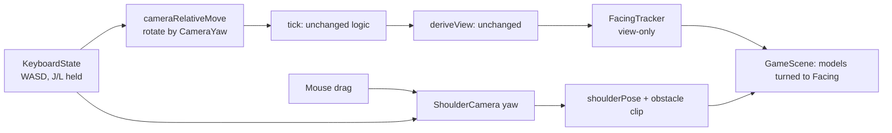

# Design Document: Shoulder View

## Overview

The change lives in the view and input layers. The logic still takes a world-space move vector per tick, so `src/core`, `src/sim`, and `src/level` do not change. Data flow per frame:



All new math is pure and tested without WebGL: `src/view/shoulder.ts`.

## Decisions

| Topic | Choice | Status | Why / change cost |
| --- | --- | --- | --- |
| Yaw convention | Yaw 0 looks toward −Z; forward = (sin y, −cos y), right = (cos y, sin y) | Provisional | Yaw 0 reproduces the old mapping, so tests that walk with WASD still hold at the start |
| Orbit keys | J left, L right, 2.2 rad/s; mouse drag 0.005 rad/px | Provisional | Q, E, F, V, R, C are taken (T and G were taken until 2026-11-20, when they were removed). Low cost: constants |
| Camera follows facing? | Yes while moving: `followYaw` eases yaw toward the heading at rate 3/s. Manual orbit holds it for 1 s. No follow while standing (look around) or when the heading is over 100° off (walking toward the camera). Tab aligns at once. WASD maps against a yaw **latched** when a move key goes down and kept until all move keys are up, so following does not feed back into the input | Provisional (F-1; latch added after review N-1) | Holding A or D walks straight sideways while the camera swings behind the walk; no circling. Constants in `shoulder.ts` |
| Facing source | Direction of movement between frames, view-only | Matches PR #3 / final-assets ("facing from movement direction") | No logic field added |
| Camera profiles | Duck: dist 1.1, eye 0.42, side 0.22, look 0.22. Child: 2.3 / 1.5 / 0.42 / 0.6. Adult: 2.6 / 2.0 / 0.5 / 0.9 (m) | Provisional (Child and Adult lowered look point after review D-2 so the whole body is in frame) | Eye height ordered Duck < Child < Adult; all below the 2.7 m ceiling and Duck below the hole lid |
| Transitions | Character switch: 0.4 s blend, and each blended eye passes through `safeEye` (clear line to the new character, below the ceiling, under the hole lid). C on/off: instant cut | Provisional (Codex review fix) | A cut is simpler and safe; a fade can replace it later |
| Obstacle clipping | 2D segment vs. AABB (walls, NPCs, locked door blocker), boxes grown by 0.12 m. Two steps: pivot → shoulder point, then shoulder point → eye | Provisional | Walls are full height, so a 2D test is exact for walls. Two steps keep the camera in line inside the 0.4 m NarrowHole instead of collapsing onto Duck |
| Wall height | Visual walls 2.6 m, indoor ceilings at 2.7 m; Overview cuts walls to 1.0 m and hides ceilings | Provisional; **conflicts with final-assets design** (see below) | |
| NarrowHole | Visual lid over the corridor and a lintel above the hole at 0.55 m. Eye clamped to ≤ 0.45 m while it is inside the hole box | Provisional | The hole reads as a hole in the wall; the camera follows Duck inside |
| Carried Duck (Child, 2026-11-20) | The Child GLB has no `socket_carry`; Duck's center group is placed at the Child's `socket_hand_r` world position, turned like the Child (no socket tilt). Placeholder Child: 0.55 m center, 0.3 m in front. Never above the head, never on Adult | Provisional | No asset change |
| Carried Duck | Its GLB bottom follows Adult's `socket_carry` world position/rotation; current model-local anchor is (-0.24, 0.90, +0.20) m. The center group is offset by 0.15 m. Primitive fallback stays 0.3 m forward | Actual exported socket, verified with combined-model render and transform test | Logic keeps `duck.pos = adult.pos` |
| Labels | Zone and fixture labels depth-tested (hidden behind walls). Character and item labels stay on top. Screen-space declutter each frame: controlled character > key items > other characters > fixtures > rooms; a label overlapping a higher one is hidden. The controlled character's label shows in the overview only | Provisional (review D-4) | Pure `declutter` in `labels.ts`, tested |
| View after checkpoint load / new game | Camera yaw, input latch and facing reset to `CHECKPOINT_VIEW_YAW` (start looks toward the NarrowHole) | Provisional (N-1, D-1) | |
| Bodies next to the lens or in the way | Non-active characters fade (`bodyOpacity`: near the lens 0.6–1.3 m, or on the eye → controlled-character line, to 0.3) | Provisional (D-1, N-6) | |
| Orbit while walking | Manual orbit shifts the latched input yaw by the same delta; automatic follow does not | Provisional (N-4) | Keeps N-1 fixed and lets the player steer with J / L / mouse |
| Label placement | `declutter` moves a lower label up/down by whole heights (±2 steps) before hiding it. Route rooms rank with fixtures. Overview turns off depth test for room/fixture names | Provisional (N-5) | |
| Connected models | Duck, Child, Adult and sauna hat from asset main `2f0261d`; all reference → Meshy 6 Lite → Blender → GLB, CC BY 4.0 with notices and sidecars | Exact hashes/measurements in `assets/manifest.json`; structural tests | Environment/remaining props are still primitives; human meshes have no rig |
| Model entry point | `CHARACTER_MODEL_URLS` + `GameScene.setCharacterModel(id, root)`; loaded with three's `GLTFLoader` in `main.ts` | Provisional; narrow seam for PR #3 | See below |

## Alignment with PR #3 (ModelAdapter, open, not merged)

PR #3 (`feat/final-assets-model-adapter`) adds `src/view/models.ts` (`ModelLibrary.load/parse/get`, `findSockets`, `measureModel`, `checkBounds`) and `GameScene.useModels(lib)`. This spec reads it only; it does not merge, cherry-pick, or copy it.

Kept the same as PR #3:

- Export contract: meters, +Y up, front +Z, bottom-center origin; `rootY = centerY − radius` (Duck) and `centerY − height / 2` (humans).
- Socket names `socket_hat`, `socket_label`, `socket_carry`, `socket_hand_r`.
- Facing from the movement direction, view-only. A load error keeps the primitive and logs a warning.

Conflicts to resolve when PR #3 is merged:

1. **Facing math**: PR #3 computes facing inside `GameScene` from `lastPos`. This spec computes it in `FacingTracker` (pure, tested) and also uses it for the camera switch. Resolution: `useModels` should read facing from `FacingTracker`.
2. **Two entry points**: PR #3 has `ModelLibrary` + `useModels`; this spec has `CHARACTER_MODEL_URLS` + `setCharacterModel`. Resolution: keep `ModelLibrary` as the loader and let `useModels` call `setCharacterModel` per loaded character; then remove the direct `GLTFLoader` call from `main.ts`.
3. **Carried Duck**: PR #3 parents Duck's root to `socket_carry`. This branch applies the same socket world pose to Duck's center group with the 0.15 m offset. Keep one path, preserve the actual asset socket, and do not apply the fallback offset twice.
4. **Label anchor**: PR #3 moves the label to `socket_label`. This spec keeps the bottom-anchored label (commit `04cb179`). With a model, use the socket position as the anchor and keep the bottom anchoring.
5. **`scene.ts` edits overlap** (character construction and `render`). Expect a manual merge.

## Conflict with the final-assets design

`final-assets/design.md` sets visual walls to 1.0–1.2 m as a diorama cutaway, because the old follow cameras looked over the walls. The ShoulderCamera sits inside the rooms, so low walls would show every room at once and the camera rule "does not pass through walls" would mean little. This spec sets 2.6 m walls with ceilings and keeps the cutaway only for the Overview. The final-assets wall kit needs a 2.6 m height (or a modular upper part). That design should be updated when the bath kit is planned; this spec does not edit it.

## Conflict with the prototype spec

`prototype-core-gameplay/design.md` describes a fixed-direction follow camera ("W always means up the screen", in `camera.ts`). That line is replaced by a pointer to this spec. The old `followPose` and `CAMERA_OFFSET` are removed; `blendPose` stays for the switch blend.

## Model connection plan (concrete)

Our side stays a thin connection point. PR #3 stays with the Web side; this branch does not merge, cherry-pick or copy it.

| Responsibility | PR #3 (`src/view/models.ts`, `useModels`) | This branch |
| --- | --- | --- |
| Load and parse GLB, error fallback | `ModelLibrary.load/parse/get` | Lazy `GLTFLoader` in `main.ts`, only while `CHARACTER_MODEL_URLS` is non-empty (temporary) |
| Socket lookup | `findSockets` (4 names) | Model-local hat/hand/carry/label names; human contract checks before replacing primitives |
| Bounds check vs manifest | `measureModel`, `checkBounds` | none |
| Place model root, hide primitive | `useModels` + `render` | `GameScene.setCharacterModel(id, root)` |
| Facing | from `lastPos` in `GameScene` | `FacingTracker` (also drives the camera) |
| Hat on Duck | `placeHat` (position only — defect, Req 6.5) | `placeAtSocket`: world position and rotation, tested |
| Carried Duck | root at `socket_carry` | `placeCharacterAtSocket` applies world pose plus body-center offset; fallback stays 0.3 m forward |
| Model list | none | `CHARACTER_MODEL_URLS` in `src/view/modelEntry.ts` |

Unifying at integration (whoever merges second does this):

1. Keep `ModelLibrary` as the only loader. `main.ts` calls `lib.load(id, url)` for each `CHARACTER_MODEL_URLS` entry, then `scene.setCharacterModel(id, lib.get(id).root)`. Delete the direct `GLTFLoader` call.
2. `useModels` becomes a loop over loaded ids that calls `setCharacterModel`. Keep one placement code path.
3. Facing: remove `lastPos` from `GameScene`; use `FacingTracker`.
4. Hat: replace `placeHat` with `placeAtSocket` (position and rotation). Keep the Req 6.5 test.
5. Carry: retain the current tested root-on-socket placement, or parent Duck's GLB root to the socket while preserving label/fade behavior. Do not apply the 0.3 m primitive fallback offset to a loaded Adult. Held items follow each human's `socket_hand_r`; exactly one outfit is visible before first draw and on clothing changes.
6. Run both test files (`tests/models.test.ts` from PR #3, `tests/shoulder.test.ts`) after the merge.
7. PR #3's `tests/models.test.ts` asserts that every `assets/manifest.json` entry still has `measured === null`. That test cannot hold once a real asset is measured (the Duck GLB is the first). At integration the Web side replaces it with a bounds check of each measured entry against its limits (`checkBounds`), and keeps `null` allowed only for assets that do not exist yet.

### Integrated model assets

Duck, Child, Adult and the sauna hat are present and registered with relative `models/*.glb` URLs so the build base path is respected. Their reference images, original Meshy outputs, Blender scenes, final files and modification records were imported from asset main `2f0261d`. They retain Meshy's CC BY 4.0 license and distributed sidecars/notices. Neither environment primitives nor test fixtures are final assets.

The equipped hat group follows Duck's `socket_hat` world position and rotation, including while Duck is carried. A human-held hat follows that person's `socket_hand_r`. In both cases the hat model's inner-base origin sits at the group origin. An equipped fallback hat follows the actual Duck group even if Duck's GLB is missing. Shelf items and other unanchored items use the derived item position. In those non-socket cases the model is lowered by the primitive's half-height. Scale is never changed.

Human visibility switches between `outfit_clothed` and `outfit_bath` before first draw and on clothing changes. Each outfit includes the head, so `head_shared` is optional. Fade transitions mark the material for recompilation when crossing the transparent/opaque boundary; otherwise Three's OPAQUE shader can ignore the changed alpha. Labels use Euclidean distance to choose the desired text size, then camera-forward depth to convert that size into world units so off-axis sprites match declutter rectangles.

## Components

```ts
// src/view/shoulder.ts (pure)
export const CAMERA_PROFILE: Record<CharacterId, { dist; eye; side; look }>;
export function forwardOf(yaw): Vec2;  export function rightOf(yaw): Vec2;
export function cameraRelativeMove(move: Vec2, yaw: number): Vec2;     // Req 3.1
export function yawFromDirection(d: Vec2): number;                     // Facing as yaw
export function clipSegment(from: Vec2, to: Vec2, boxes: AABB[], margin): Vec2; // Req 4.1
export function shoulderPose(id, focus: Vec3, yaw, obstacles: Obstacles): Pose;  // Req 1.1, 4.1, 4.2
export class FacingTracker { update(view: View): void; yaw(id): number; moving(id): boolean } // Req 3.4
export function followYaw(yaw, heading, moving, sinceOrbit, dt): number;         // Req 1.5
```

- `FollowCamera` gains `yaw`, `orbit(delta)`, and `alignTo(yaw)`. On a switch it aligns to the new character's Facing and blends 0.4 s (existing).
- `KeyboardState.orbit()` returns −1, 0, or 1 from held J / L.
- `main.ts` rotates `takeFrame().move` with `cameraRelativeMove` before `advance`, feeds orbit input and mouse drag to the camera, and loads `CHARACTER_MODEL_URLS`.
- `GameScene`: 2.6 m opaque walls, ceilings, hole lid and lintel; `setOverview(on)` cuts walls and hides ceilings; characters turned by `modelRotationY(yaw) = π − yaw`; a small front marker on the human primitives so the back is visible; Duck's beak at +Z.

## Testing

- `cameraRelativeMove`: yaw 0 keeps the old mapping; yaw π/2 maps W to +X; length stays ≤ 1.
- `shoulderPose`: eye behind and right of the character; eye height Duck < Child < Adult; below the ceiling; inside the NarrowHole the eye stays inside the corridor and under the lid.
- `clipSegment`: a camera behind a wall is pulled in front of it; no segment from a character to its eye crosses an Obstacle at sampled positions along the route.
- `FacingTracker`: moving sets the facing; standing keeps it; a carried Duck follows Adult.
- `KeyboardState.orbit`: J / L held.
- Existing suites unchanged except the old camera offset tests, which move to the new profiles.
- Browser: single-key checks by Crew (C toggle, switch). Held-key play is done later by Codex via live takeover and recorded as such.
