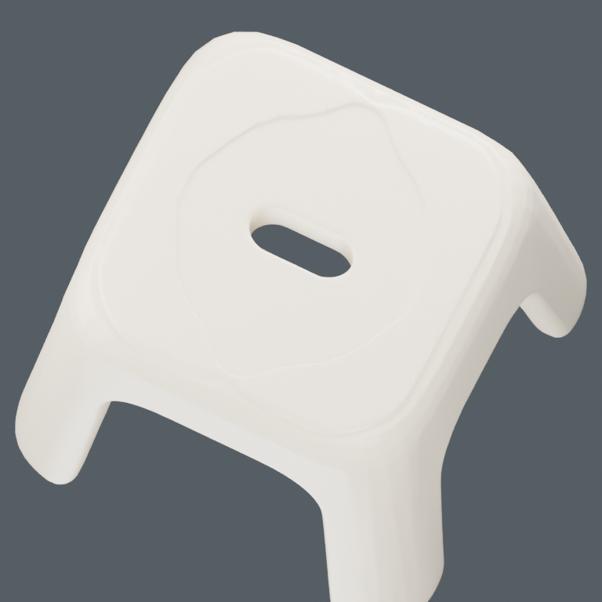
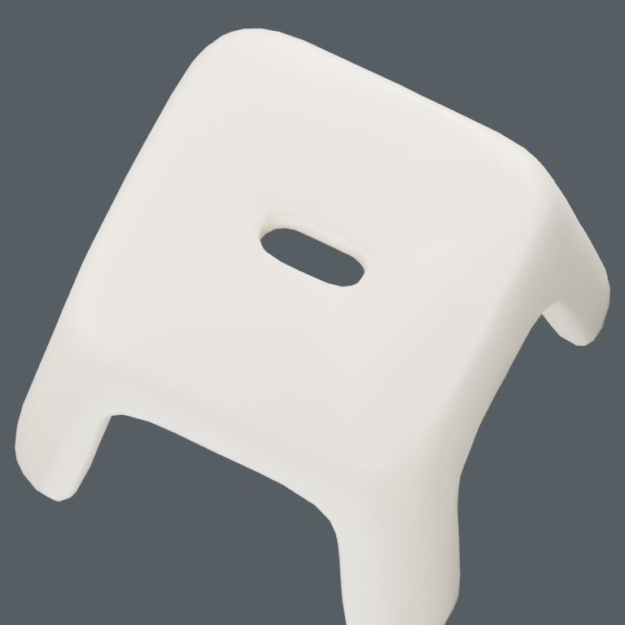
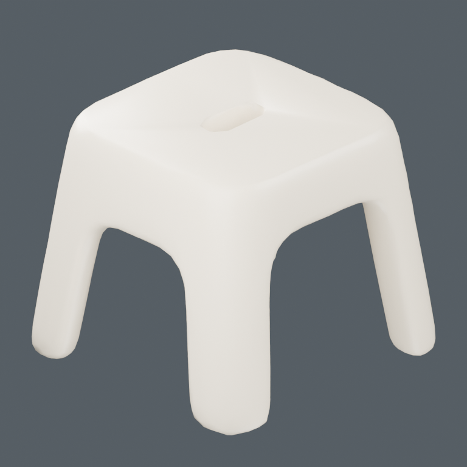
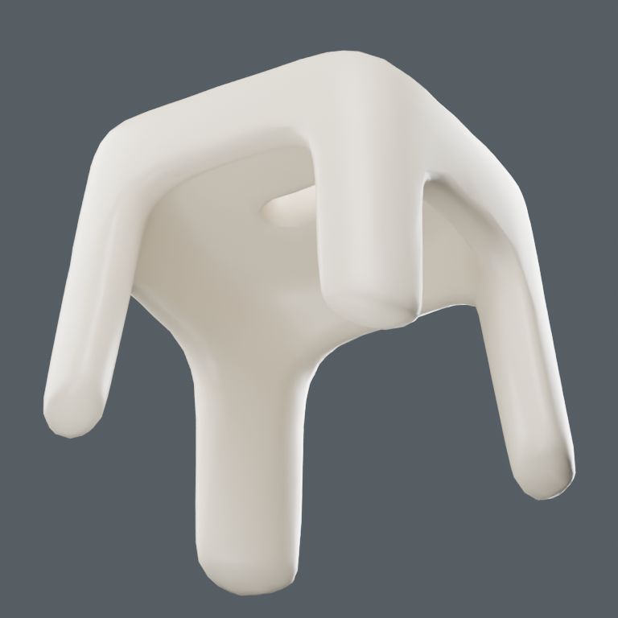

# Bath stool refinement v01

2026-11-21, Codex via Blender 5.2.4 LTS. The user chose to keep the free workflow and correct the generated shape in Blender. This is a derivative of the actual Meshy 6 Lite output, not a replacement made from stool primitives.

## Source and changes

The single-object reference is `../ref/bath_stool__ref_threequarter_v01.png`. The unmodified source is `../gen/bath_stool__meshy6lite_raw_v01.glb`: 87,590 triangles and 43,795 vertices. Its four legs and through-hole were usable, but the seat had unwanted concentric ridges and the surface and foot tips were uneven.

The working mesh uses one quadrant of that generated surface, mirrored across the two vertical center planes to regularize the legs and slot. Blender smoothing reduces surface ripples. A local height adjustment removes the upper seat ridges while retaining the existing drain opening, and foot contacts are leveled. Voxel retopology removes collapsed strips and seam slivers; further local smoothing softens the generated foot-tip lips. The adjusted surface is then reduced, assigned one ivory satin-plastic material, and fitted to the existing game envelope. No new stool body, legs or hole are substituted as primitives.

The editable `bath_stool__v01.blend` contains:

- `SOURCE_RAW_UNMODIFIED`: the original imported source mesh and transform, hidden from the export.
- `bath_stool_adjusted_before_reduction`: the adjusted source surface before triangle reduction, hidden from the export.
- `bath_stool`: the exported 3,000-triangle mesh.

The `.blend` is compressed to reduce repository storage. The separate raw GLB remains byte-for-byte unchanged. After reopening the compressed scene, the stored original's 43,795 vertex positions, 87,590 polygon index lists and object transform matched a fresh raw-GLB import exactly. `scripts/finish-bath-stool.py` reproduces the adjustment, saves the editable file, exports `public/models/bath_stool.glb`, reimports it, measures it and renders six views. Its `inspect` mode renders the source with normalized dimensions and a plain material for comparison without changing the raw file.

## Export and checks

The candidate GLB is **3,000 triangles, 1,500 vertices, 55,568 bytes**, one mesh, one primitive, one material and no textures, images, animations or sockets. Dimensions are **0.36 × 0.30 × 0.36 m** (X × Y × Z), bottom-centered, +Y up and +Z front. The glTF bounds are approximately `[-0.18, 0, -0.18]` to `[0.18, 0.30, 0.18]`.

Reimported geometry has zero nonmanifold edges, zero degenerate faces, finite vertices, one connected component, four separate lower legs below 0.14 m, and an unobstructed vertical ray through the central drain. All four foot minima lie within 0.1 mm of the floor. Measurements and raw/editable/export SHA-256 values are in `bath_stool__measurements_v01.json`.

A 1,200-triangle trial visibly degraded the drain and foot contours and was rejected. A roughly 4,000-triangle trial offered little visible improvement over the selected 3,000-triangle version. The recommended triangle allowance is therefore **3,000 per stool / 15,000 for five instances**, with the shared design-budget change handled separately. The 100 KB file-size target remains satisfied.

The reimported export was inspected at front, both three-quarter views, back, top and underside. The repeated seat rings are removed; the drain is open and the four legs remain distinct. The raw comparison and final images are retained for all six views. Minor polygonal contours remain visible around feet and the slot at close inspection. The generated underside and silhouette are an approximation of the reference, not an exact manufactured-object reconstruction. Game lighting, low-camera appearance, label clearance and repeated-instance appearance remain for final in-game verification.

Private-path, personal-mail and common token-prefix markers were checked in the raw GLB, final GLB and uncompressed editable-scene data. No scoped matches were found. This is a limited metadata check, not an exhaustive security or rights audit.

This record covers asset production and local shape checks. It does not claim runtime registration, shared manifest/ledger completion, independent review, normal-input play or user acceptance. Those are handled separately by the supervising session. No paid service was used for this correction.

License: **CC BY 4.0**, attribution **Meshy**, with Blender modifications by the Sento Duck Explorer project. Applies to the generated and adjusted meshes, editable scene and derived previews. See [attribution](../ATTRIBUTION.md); the reference PNG has separate terms.
