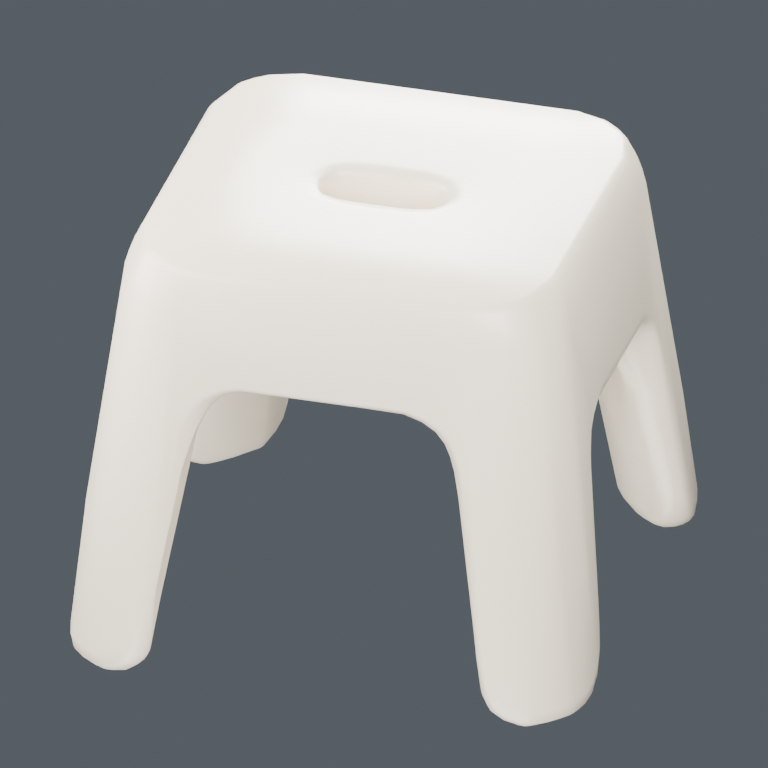
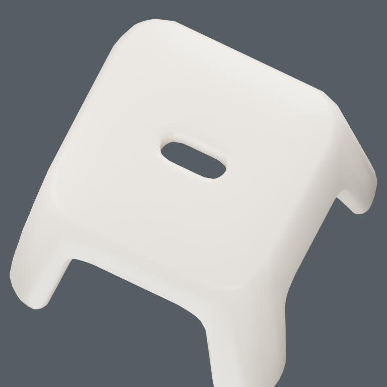

# Bath stool refinement v02 — source-derived supported retopology

2026-11-21, Blender 5.2.4 LTS. This is the selected local finishing candidate, made with free Blender features from the actual Meshy output. Final game-view verification and user acceptance remain separate decisions.

The unchanged source is `../gen/bath_stool__meshy6lite_raw_v01.glb`, SHA-256 `bec685cdace5e895485a3391c5fa114088014659dc54c22cd1fa988d9f4d0cf5`. The reference remains `../ref/bath_stool__ref_threequarter_v01.png`. The saved raw object's complete vertex coordinates, polygon indices and transform were compared with a fresh source import and matched exactly.

## What was measured and changed

The raw was normalized to the existing 0.36 × 0.36 m footprint and 0.30 m height on a separate working copy. Radial ray intersections measured the drain wall, exterior wall, inner wall and lowest arch/foot outline. Measurements from four quadrants were combined by their median. `../quality/v02/source-sections.json` records the source and regularized section values.

A new quad control surface follows these measured sections. It retains the generated four-leg layout, side arches, seat extent, hollow underside and central through-slot. This is a retopology of the generated surface, not a generic replacement assembled from stool primitives. The first version used polar angles that were too sparse on steep arch flanks; it was rejected. The final sections use lower-outline arc length, with extra correspondence points at the feet.

The deliberate reference-based corrections are removal of the generated concentric seat ridges, a flat seat annulus, supported rounding at the slot and seat perimeter, regularized symmetric wall sections, and level foot contacts. These are design corrections; the reference does not determine the hidden underside exactly. The radial measurements establish source correspondence, not a proof of reference-image fidelity.

Fixed-lighting review found a remaining side-arch shoulder crease in both the reduced mesh and its detailed master. Near the opening, source radial hits were already bending into the lip and were unsuitable as outer-wall support points. The correction uses the stable source sections at heights 0.245 and 0.270 m to fit the outer taper, plus measured foot/arch wall thicknesses to regularize the inner transition. Its influence is limited to the side-arch shoulders, smoothly blended between heights 0.12–0.18 m and quadrant angles 25–45°. A trial extending that correction down the whole leg changed the rounded feet and was rejected. The local version restored the feet while removing the sharp arch fold. The previous fixed candidate and matching comparisons remain in `../quality/v02/iterations/`.

Mirror and Subdivision remain editable on the detailed quad master. No whole-mesh voxel remesh or collapse decimation was applied. A 22,464-triangle evaluated comparison surface is retained separately. A trial with fewer structured cage rows/columns did not preserve the feet and arches sufficiently. The final runtime surface instead preserves 912 feature edges and merges near-planar regions at a maximum 7.5° threshold, then triangulates and transfers custom normals from the supported detailed surface. This is still a geometric approximation; it does not preserve every original sample.

## Candidate and checks

The candidate has **4,610 triangles, 2,305 vertices, 84,676 bytes**, one material and no textures. Its X × Y × Z glTF dimensions are **0.36 × 0.30 × 0.36 m**. It is bottom-centered. SHA-256: `1df13475185623882db1d63d99cc52f9ebff03cc40d62fb5136672a4f7515e55`.

Fresh GLB import confirmed one connected component, four separate legs below 0.14 m, zero nonmanifold edges, zero degenerate faces, finite vertices and zero foot contact heights. Five positions inside the drain were ray-tested both downward and upward, and all were clear. Exported custom normals survived reimport.

A sampled comparison against the 22,464-triangle surface includes vertices and triangle centroids in both directions. High → runtime: mean **0.409 mm**, 95th percentile **1.596 mm**, maximum **3.289 mm**. Runtime → high: mean **0.120 mm**, 95th percentile **0.579 mm**, maximum **3.075 mm**. Detailed foot samples below 0.08 m differ from the pre-arch-correction detailed surface by a 95th percentile of **0.025 mm**, maximum **0.647 mm**. These are sampled nearest-surface distances, not a continuous Hausdorff bound or an image-fidelity score. The complete results, source hashes and reasons for rejecting intermediate candidates are in `../quality/v02/measurements.json`.

Self-review used the reimported candidate at front, three-quarter, a reference-like angle, top and underside, plus matching views of the detailed comparison mesh. Independent asset QA checked the arch correction and recovery of the rounded feet. The revised slot/seat boundary and foot/arch contours are clearer than the first retopology trial. The slot is visibly open in the top view; its appearance as a shallow recess from a low angle is affected by the visible inner wall and underside fill light. The single reference's material/lighting and hidden geometry have not been exactly reconstructed. Light polygonal contours remain visible in close-ups. Final fixed-camera evidence is linked from the asset README; game lighting and normal-input verification remain deferred.

## Editable file and reproduction

`bath_stool__v02.blend` contains separate collections for the untouched source, normalized measurement copy, editable master, evaluated comparison surface, a rejected reduced-cage experiment, and the exported runtime object. Only `bath_stool` is exported. The experimental reduced cage is retained for process evidence and is not the final runtime mesh.

Run `scripts/refine-bath-stool-v02.py` from the repository root with Blender in background mode to regenerate this selected version and preview images. Run the same script with `-- --audit` to verify the existing fixed export, raw preservation, bidirectional sampled errors and metadata. The audit does not rewrite the candidate GLB or deliverable Blend. `-- --archfix` writes the same local correction to isolated experiment paths; `-- --legacy-arch` explicitly reconstructs the earlier arch method into separate legacy paths. Normal generation and audit default to the selected local arch correction.

The compressed Blend was checked through a temporary uncompressed copy; both GLBs and eight preview PNGs were also inspected for private home paths, email-like strings and common token prefixes. No scoped matches were found. PNG text/EXIF metadata was removed without changing pixels. The temporary audit copy and generated `.blend1` backup were removed. This is a heuristic metadata check, not an exhaustive security or rights audit.

License: **CC BY 4.0**, attribution **Meshy**, with Blender modifications by Sento Duck Explorer. Applies to generated/adjusted meshes, editable scene and derived previews. The reference PNG has separate terms. See `../ATTRIBUTION.md`.

