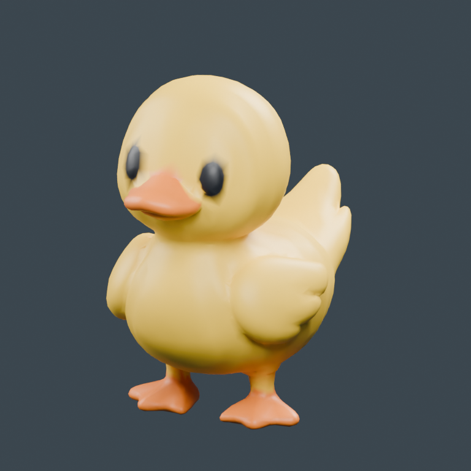

# Duck: Blender adjustment and export

Codex adjusted the actual Meshy output in **Blender 5.2.4 LTS** on **2026-11-20**. `duck__v01.blend` is the editable scene; `../../../public/models/duck.glb` is the game export. SHA-256 values for the exact files are in `../../ledger.csv`.

## Actual modifications

1. Imported the preserved GLB from `../gen/duck__meshy6lite_raw_v01.glb`. Its front already corresponded to glTF +Z / Blender -Y.
2. Applied Blender's collapse Decimate operation to the original mesh, reducing **90,266 to 5,800 triangles**. Kept its anatomy and used smooth normals. No replacement primitive meshes were added.
3. Painted vertex colors onto the existing geometry: yellow body and wings, orange beak and feet, and dark eyes. One PBR material uses those colors, with metallic 0 and roughness 0.48. No texture files are required.
4. Applied a uniform metric scale to make the mesh **0.30 m high**. Placed its origin at the bottom center of its horizontal bounds. The exported axes are +Y up and +Z forward.
5. Added `socket_hat` at glTF **(-0.002286, 0.270000, 0.043790) m**. A render with the actual exported sauna hat confirmed the fit: its inner-base origin sits 0.03 m below the duck's head top, so the hat surrounds the crown without hiding the eyes. The provisional `socket_label` is at **(-0.002286, 0.460000, 0.043790) m**, above the equipped hat rather than inside it. Both are empty nodes and are excluded from mesh bounds. Exact coordinates are recorded in the duck's `socket_positions` in `../../manifest.json`.
6. Saved the editable Blender scene and exported glTF 2.0 binary using Blender's **glTF exporter 5.2.41**. Exported only the duck mesh, root, and two sockets; no cameras, lights, animations, or external resources.

## Measured export

| Property | Measured value |
| --- | --- |
| Height | 0.300000012 m |
| Width, X | 0.196388379 m |
| Depth, Z | 0.302433223 m |
| Maximum horizontal extent | 0.302433223 m; limit 0.36 m |
| Triangles | 5,800; limit 6,000 |
| Vertices | 2,902 |
| Materials / textures | 1 / 0 |
| Non-manifold edges after reimport | 0 |

The exported GLB was reimported into Blender. Bounds, bottom-center origin, triangle count, material, vertex colors, and both socket names were checked. The adjusted model was visually inspected from four directions; the preview below is a render of the **reimported GLB**, not the source image. The editable `.blend` was reopened and its scene, mesh, material, and sockets were checked.

The Blender file's file-browser state was cleared before saving. Binary metadata checks found no personal-path, email, credential, or private-service-URL patterns in the published Blender and GLB files. The GLB has no external URIs. These are scoped checks, not a blanket guarantee about all binary metadata.

**Status:** reference image → Image to 3D → Blender adjustment → GLB export has been performed for this duck. Game integration, camera presentation, and the browser route pilot are separate checks; this asset record does not claim they are complete. The model and this derived preview remain **CC BY 4.0**; see [Duck attribution](../ATTRIBUTION.md).
