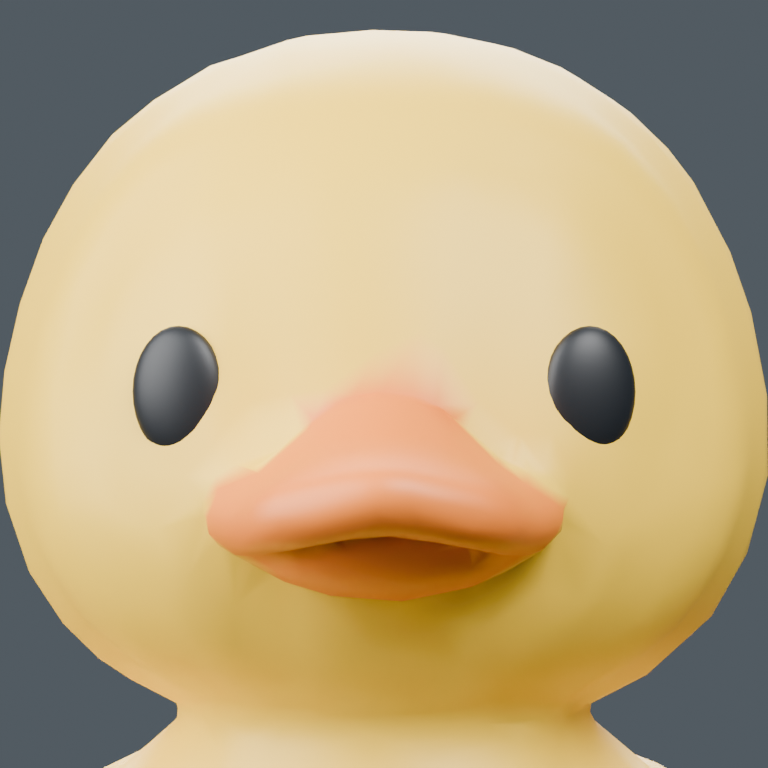
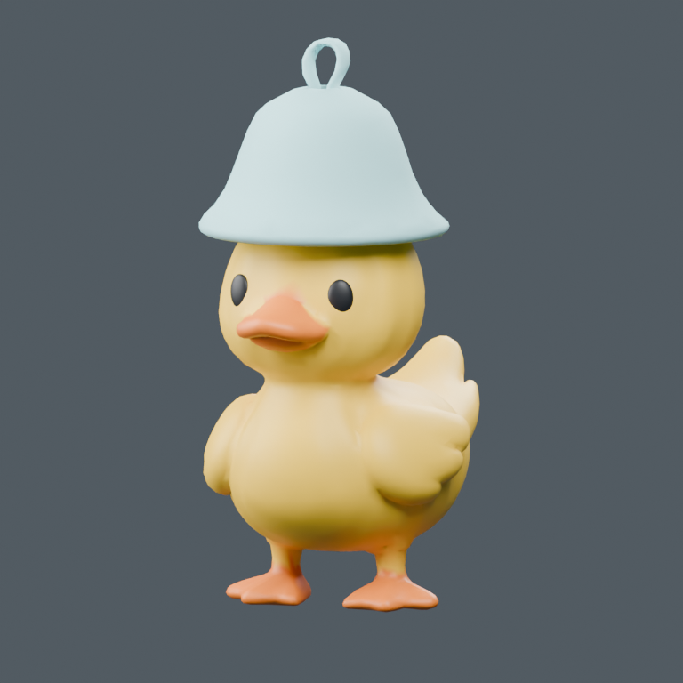

# Duck eye refinement v02

2026-11-21, Codex via Blender 5.2.4 LTS. The user reported malformed eyes. The previous low-poly dark eye patches had irregular contours and unequal heights. The existing generated body is retained. This is a local revision of the original reference → Meshy → Blender asset, not a new Image-to-3D generation.

## Changes

- Removed the old dark eye vertex colors and smoothed only their surrounding creased surface with a weighted Blender Smooth modifier.
- Added two matched smooth ellipsoid eye inserts. Both have 9.5 × 4.2 × 13 mm radii, mirrored horizontal positions and the same height. Each is fitted to its corresponding head surface; the original head is slightly asymmetric in depth.
- Kept the original 5,800 body triangles, metric scale, bottom-center origin, material and vertex-color workflow. The two inserts add 1,920 triangles: **7,720 total**, within the revised provisional 8,000 limit. One mesh/material, no textures, 187,588-byte GLB.
- Kept the entire model bounds and the exact `socket_hat` / `socket_label` positions. No gameplay or collision change. The eye inserts intersect the closed head slightly by design, so they stay seated on the surface.
- Removed unused UV maps to avoid unnecessary seam splits in the vertex-color export. Reimported topology has zero nonmanifold edges; vertices are finite.

`duck__v01.blend` and `duck__v01.glb` preserve the earlier version. `duck__v02.blend` is editable; `public/models/duck.glb` is the updated runtime asset. The script `scripts/finish-duck-eyes.py` reproduces a review candidate from v01; it does not overwrite the runtime file automatically. Source-to-output hashes are in the ledger.

## Verification

The exported GLB was reimported into Blender and checked from the front, both three-quarter views, a close-up and with the unchanged sauna-hat GLB. Shape, black contour, alignment and hat clearance were inspected. Bounds and sockets were compared to the archived v01 export. Limited binary metadata scans found no private absolute path, private temporary path, personal-mail marker or common GitHub-token prefix. These are scoped checks, not an exhaustive metadata audit.

This local correction is **not user acceptance**, independent review, an in-game visual check or a normal-input playthrough. Those remain pending; the user deferred real play while finishing proceeds. The original source's body asymmetry and existing beak/wing/foot stylization were not redesigned.

License: **CC BY 4.0**, attribution **Meshy**, with Blender modifications by the Sento Duck Explorer project. Applies to the adjusted mesh, editable scene and derived previews. See `../ATTRIBUTION.md`.
