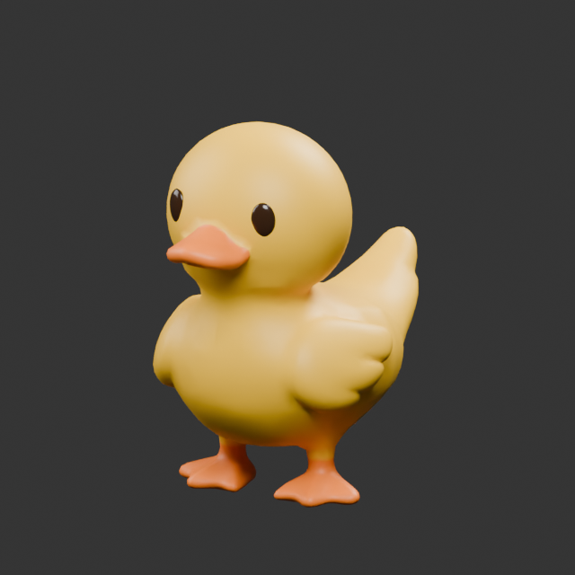

# Duck surface and material refinement v03

2026-11-21, Blender 5.2.4 LTS. This revision addresses the existing Duck's reconstructed surface ridges, irregular painted beak/ankle edges and overly coarse facial treatment. It uses the received Meshy 6 Lite geometry from the original reference → Meshy → Blender lineage.

## Source and editing method

- Reference: `../ref/duck__ref_threequarter_v01.png`.
- Source: `../gen/duck__meshy6lite_raw_v01.glb`, SHA-256 `ea745e2c7d06b64610fc8791124c0e325b92007637d627da372b9aa7a9f3b727`. The hidden `SOURCE_RAW_UNMODIFIED` object's vertex coordinates and face indices match a fresh source import exactly.
- A uniform scale of 0.159164536557 maps the original 1.884842 m source height to 0.300 m, with the original bottom-center convention. Old bounds and the normalized-source mapping are recorded in `../quality/existing-review/measurements.json`; v03's corrected bounds are measured independently rather than forced to v02's vertex extrema.
- The editable, detailed source mesh retains 90,266 triangles. A least-squares symmetric quadric is fitted from actual source-head samples. Projection is restricted to the head, blended at the neck, and excludes the beak and rear tail. The source's carved eye bumps and banded cheek curvature are removed in that region.
- Local beak fairing removes small ripples. A separate torso mask smooths the chest/belly and tail-root reconstruction grooves. The wings' rounded front/underside, their three feather tips, the tail silhouette and the feet are protected. This is recorded as an editable vertex group in the master.
- Imported custom normals are reset after deformation. The detailed corrected surface supplies normals to the 6,400-triangle runtime body.
- The yellow/orange palette is repainted on the corrected source and baked to a packed 1,024 × 1,024 sRGB base-color texture. Color boundaries are evaluated after geometry correction, so orange does not spread over the cheeks. `duck_body` has its own body material; `duck_eyes` has a glossy dark-brown material. The two eye inserts use matching 10 × 3.8 × 14 mm radii and 896 triangles combined. Their measured centers are in the JSON report.

## Candidate and checks

- Runtime: **7,296 triangles**, 2 materials, 1 embedded texture, **350,388 bytes**.
- glTF dimensions (X × Y × Z): **0.196387 × 0.298510 × 0.302421 m**; bottom Y = 0.
- GLB SHA-256: `75ca48aec7a8f19d2563dbd4a3f64940b3b299bf6f6d83d09e6283663d557ef2`.
- Editable Blend SHA-256: `ae7d94e53e3c731ef3d84a037a1e7f6f5a2a9ea11ce188d3d0d813450cdef1bc`.
- `socket_hat` and `socket_label` retain their exact original matrices. Source-coordinate and socket comparisons are executable checks.
- Reopened Blend, freshly reimported GLB, front/side/back/three-quarter/underside/face images, and the fitted-hat combination were examined. After welding export UV seams at 1e-7 m, both body and eye meshes have zero nonmanifold edges and no degenerate faces. Eye/head intersections are intentional inserts.
- PNG text/EXIF chunks were stripped. Packed image and packed-file paths are relative; decompressed Blend scans found zero tested private-path markers. All GLB images are embedded. These scoped checks are recorded in `../quality/existing-review/audit.json`.
- Independent geometry review accepted the restored wing arc and the smoother chest/tail-root for final fixed-camera comparison. The common comparison and its final disposition are recorded by the integration session.

## Rejected trials and remaining limits

Feature-weighted collapse trials concentrated triangles in the wrong regions and damaged the torso; these were rejected visually. A height-only head mask pulled the tail into the head fit, so the region was corrected before selection. Chest-only fairing left rear dimples; broad fairing then erased the wing's leaf-shaped front, so the mask was narrowed to preserve that surface. Images/measurements of representative failures remain under `../quality/existing-review/iterations/`.

The distant side/back of the original single reference is not fully constrained. This remains a stylized source-derived toy, with some faceting visible in a close silhouette and a deliberately shallow wing/body seam. Standardized offline inspection does not establish in-game appearance or user acceptance.

Reproduce candidates with `Blender --background --python scripts/refine-duck-hat.py -- --asset all` from the repository root. The script writes review candidates, editable masters and evidence; runtime promotion is a separate integration step. `--asset verify` repeats source/reimport/attachment/metadata checks, and `--asset sanitize` updates only packed paths in the saved Blends.

License: **CC BY 4.0**. Attribution: **Meshy**, with Blender modifications by the Sento Duck Explorer project. Applies to the source-derived mesh, editable scene, baked texture and previews; see `../ATTRIBUTION.md`.
