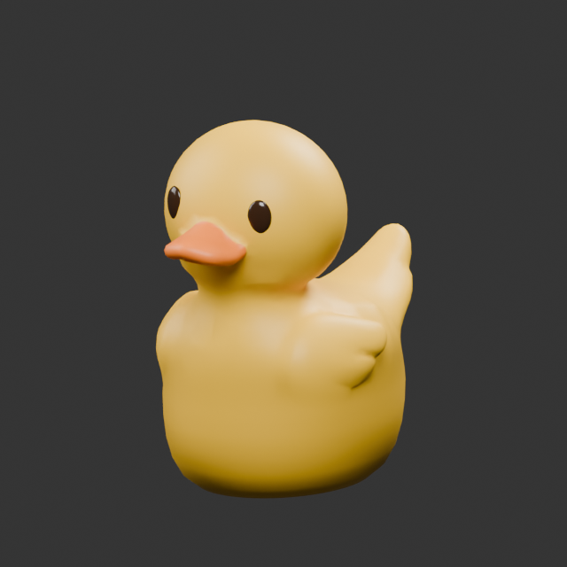

# Footless rubber duck v04

2026-11-21, Blender 5.2.4 LTS. This revision removes both legs and feet and gives the Duck one rounded, closed lower body with a flat contact patch. It follows the user's request for a footless rubber duck and continues the original reference → Meshy → Blender lineage.

## Source and local editing

- Starting scene: `duck__v03.blend`, SHA-256 `ae7d94e53e3c731ef3d84a037a1e7f6f5a2a9ea11ce188d3d0d813450cdef1bc`. The previous runtime is preserved as `duck__v03.glb` with SHA-256 `75ca48aec7a8f19d2563dbd4a3f64940b3b299bf6f6d83d09e6283663d557ef2`.
- Original source: `../gen/duck__meshy6lite_raw_v01.glb`, SHA-256 `ea745e2c7d06b64610fc8791124c0e325b92007637d627da372b9aa7a9f3b727`. The reopened v04 Blend's hidden `SOURCE_RAW_UNMODIFIED` matches a fresh raw import exactly: 45,135 vertex coordinates and 90,266 polygon index lists.
- A horizontal cut at Blender Z = 0.077 m removes both feet and legs. The cut is deliberately above their two separate contours and yields one connected body boundary. Its original runtime ellipse radii are 0.076860 × 0.088394 m.
- The lower belly between Z = 0.077 and 0.130 m is locally faired into a wider oval. Its displacement fades smoothly to zero at the upper boundary. This removes the narrow leg-root pinch while retaining the recognizable feather tips, head, eyes, beak, chest and tail. The maximum runtime vertex displacement in this band is 0.023759 m; 925 vertices are in the edited band. The faired contour radii are 0.087 × 0.112 m.
- Six runtime rings follow a cubic profile from that contour to a flat elliptical contact patch at Z = 0. The profile is horizontally tangent at the bottom and smoothly joins the faired belly at the top. The bottom is closed with triangles; there are no separate feet, leg remnants or orange toe surfaces. The detailed source-derived master uses twelve rings and retains 81,522 triangles.
- Every original triangle wholly above Z = 0.130 m retains its exact positions and UVs: **3,013 runtime triangles**. Their original custom corner normals are retained rather than recalculated across the head. Blender's normal re-encoding has a maximum component error of **0.000265241** in this preserved region and in the head; the executable bound is 0.001. Only the lower band and new underside receive new normals.
- The eye geometry, eye material color, body texture pixels, root matrix, and both socket matrices are unchanged. The cap samples a uniform yellow region of the existing packed texture. No extra texture or material is introduced. Independent direct GLB comparison also confirmed identical preserved upper triangle positions/UVs, all 896 eye triangles, material definitions, samplers, and the complete embedded PNG bytes.

## Final asset and checks

| Measurement | v04 |
| --- | --- |
| Runtime triangles | **7,214**: body 6,318 + eyes 896 |
| GLB size | **337,204 bytes** |
| Dimensions, glTF X × Y × Z | **0.191887 × 0.298510 × 0.302421 m** |
| Bottom Y | **0 m** |
| Materials / textures | **2 / 1**, existing 1,024 × 1,024 texture |
| GLB SHA-256 | `43d385d81d6f2e1f520972db33426ddaf64b33250ca89b9f50d33a14fa17b779` |
| Blend SHA-256 | `7c187ea3351a72ad2a4ad1a22128f4639353da5a62bbb9ec70a40aa216b7280e` |

The candidate GLB was freshly imported for all geometry measurements and renders. After welding export UV seams at 1e-7 m, body and eyes each have zero nonmanifold edges and zero degenerate faces. Upward rays from below the body at glTF X = −0.02, 0 and +0.02 m, Z = 0, all meet the continuous bottom at Y = 0 within 4e-9 m.

The v04 Blend was reopened before comparing the retained raw geometry, eyes, texture, root and sockets. Runtime socket matrices also match the archived v03 GLB exactly. Authored hat and adult carry placements were rendered at scale 1; the label anchor remains 0.024840 m above the hat. These are static asset inspections, not gameplay or frame-time tests.

All 14 evidence PNGs and the embedded texture PNG were checked for text and EXIF chunks; none were present. Packed image paths are relative. The decompressed Blend contains zero of the tested private-path/account markers. The GLB embeds its buffers and images and has no camera or light payload. Details: [measurements](../quality/v04/measurements.json), [reopen and metadata audit](../quality/v04/audit.json), and [attachment measurements](../quality/v04/attachments/measurements.json).

## Visual disposition and reproduction

The first two closure trials preserved too narrow a body seam and produced a cup-like pedestal. They were rejected; their render and measurement evidence remains in the private working records. The accepted revision widens and fairs the lower body itself, so the bottom reads as one continuous rubber-duck body. Independent review accepted the final front, side, underside, three-quarter and back geometry. Close views retain some source-derived stylization and a shallow wing/body seam.

Reproduce from the repository root:

```sh
Blender --background --python scripts/make-rubber-duck.py
Blender --background --python scripts/audit-rubber-duck.py -- --attachments
```

The first command writes the v04 editable scene, candidate and fixed-camera evidence. The second reopens the saved scene, compares a fresh raw import, renders authored attachments and audits the exported binary. Both keep the v03 source and evidence intact; runtime promotion is a separate integration step. Saved Blend hashes may differ when regenerated, so the generated measurements and audit must travel with their own candidate.



License: **CC BY 4.0**. Attribution: **Meshy**, with Blender modifications by the Sento Duck Explorer project. Applies to the source-derived mesh, editable scene, packed texture and previews; see `../ATTRIBUTION.md`.
