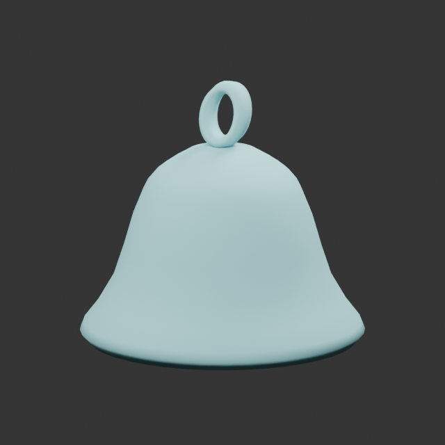
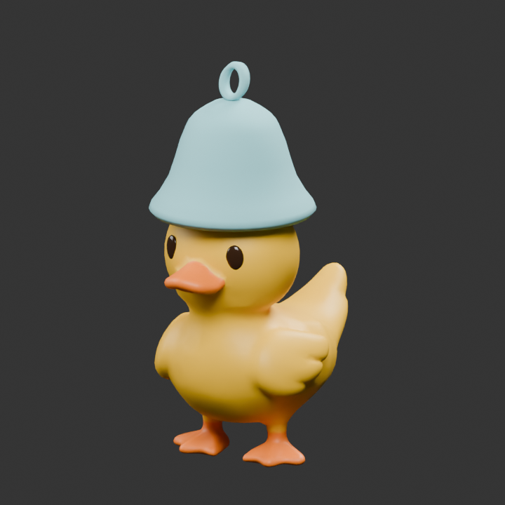

# Sauna hat source-profile retopology v02

2026-11-21, Blender 5.2.4 LTS. The original coarse runtime cap had angular shoulders, a polygonal rim and an uneven loop. This revision reconstructs its topology from measured sections of the actual Meshy source.

## Source and editing method

- Reference: `../ref/hat_sauna_duck__ref_threequarter_v01.png`.
- Source: `../gen/hat_sauna_duck__meshy6lite_raw_v01.glb`, SHA-256 `748701e961177aafc0b5050a2ba75b045d4eca5077f88d50d6a3c587a659a7c5`. The hidden `SOURCE_RAW_UNMODIFIED` object exactly matches a fresh import's coordinates and face indices.
- The 96,572-triangle source is normalized uniformly to an approximately 0.18 m diameter. Its natural proportions replace v01's separately compressed height; this is why the final height is 0.165160 m rather than 0.139973 m.
- At selected heights, 64 radial rays measure the source's outer and inner profiles. Their median radii drive the editable hollow crown/rim retopology with 40 angular segments. Extra rings preserve the crown's curved shoulder; the lower ring is open, with the original wall thickness represented by the separate inner surface.
- Source-loop silhouette samples determine its elliptical centerline and tilt by least squares. The loop uses 32 centerline segments and a six-sided thickness profile, giving a smooth outline at runtime. It is a source-measured local reconstruction, rather than an unrelated replacement hat.
- The Blend contains the untouched source, normalized detailed guide, an editable retopology master with subdivision, and the runtime mesh. The rim and loop remain separately editable within that mesh.
- Material: pale aqua, roughness 0.88, one material, no texture. Two 512 px tangent-normal trials were inspected against the same material/camera; the small visible benefit at normal review scale did not justify a rise from 38,676 to 318,796 bytes. The matte version was retained. Trial evidence is under `../quality/existing-review/iterations/rejected-felt-normal/`.

## Candidate and fit checks

- Runtime: **2,064 triangles**, 1 material, no textures, **38,676 bytes**.
- glTF dimensions: **0.179438 × 0.165160 × 0.179438 m**. The origin remains the inner-bottom center; lowest Y = 0.
- GLB SHA-256: `e6362a9bdffa39b987d30540dbc8bce061b6c867bdddee563ebd0a1bcba7bce6`.
- Editable Blend SHA-256: `b5a75820251c10c8a8986551acb1ad30cdf1d88e26e1d73a60efd6c700fcc24a`.
- The actual GLB was reimported and examined from front, side, back, three-quarter and below. It has zero nonmanifold edges and no degenerate faces. An upward ray through the center first hits the inner crown at local 0.115800 m, confirming that there is no bottom cap.
- Fitted to Duck's unchanged `socket_hat` at authored scale 1. The three attachment renders show the hat resting around the upper head without obscuring the eyes/beak. The top reaches 0.435160 m and leaves **24.840 mm** below the bottom-anchored character-label socket at 0.460 m (`LABEL_CENTER_Y.character = 0`).
- Source coordinates/faces, original sockets, finite vertices, reopened Blend and self-contained GLB were checked. PNG text/EXIF chunks were removed; decompressed Blend scans found zero tested private-path markers. The detailed report is `../quality/existing-review/audit.json`.
- The pair totals **9,360 triangles**, 200 more than the previous Duck/hat pair. The integration session verifies the complete scene's unchanged 60,000-triangle cap.

The surface intentionally stays a clean stylized matte material. It does not reproduce the reference's tiny felt fibers. Radial averaging regularizes the source crown's irregularities, and a single reference does not uniquely determine its hidden surfaces. The source and prior revisions remain preserved.

Reproduce with `Blender --background --python scripts/refine-duck-hat.py -- --asset all` from the repository root. Use `--asset verify` to repeat attachment/source/metadata checks. The optional `--felt` flag reproduces the rejected normal-map trial and is not the selected material.

License: **CC BY 4.0**. Attribution: **Meshy**, with Blender modifications by the Sento Duck Explorer project. Applies to the source-derived mesh, editable scene and previews; see [asset attribution](../README.md#attribution-and-rights).
