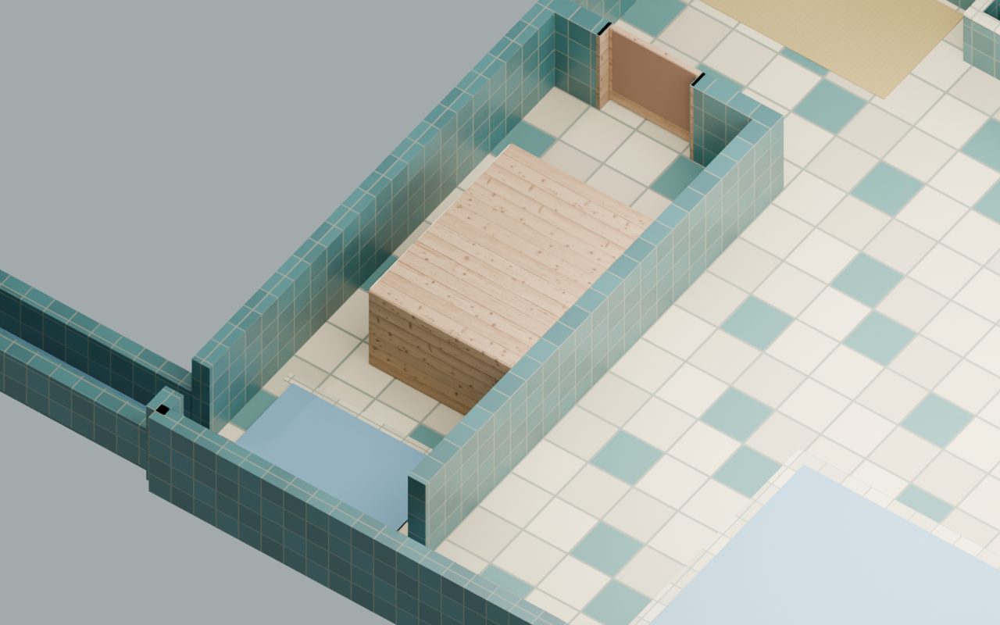
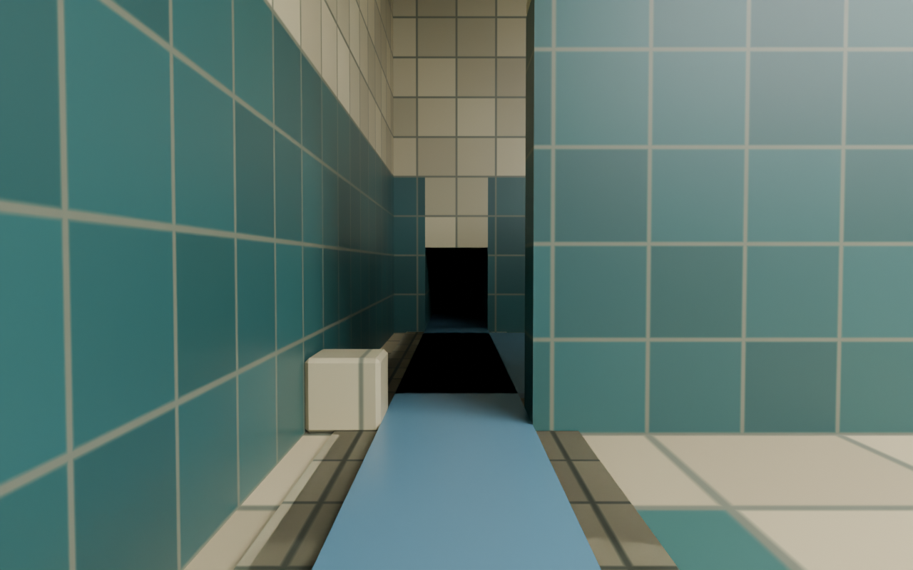
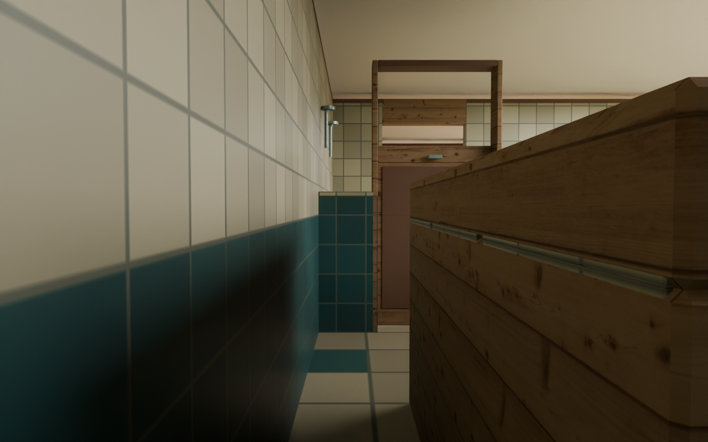
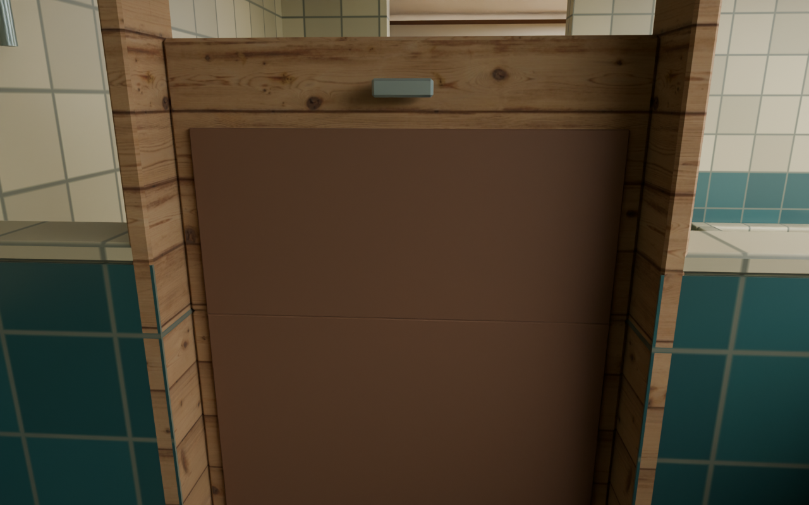
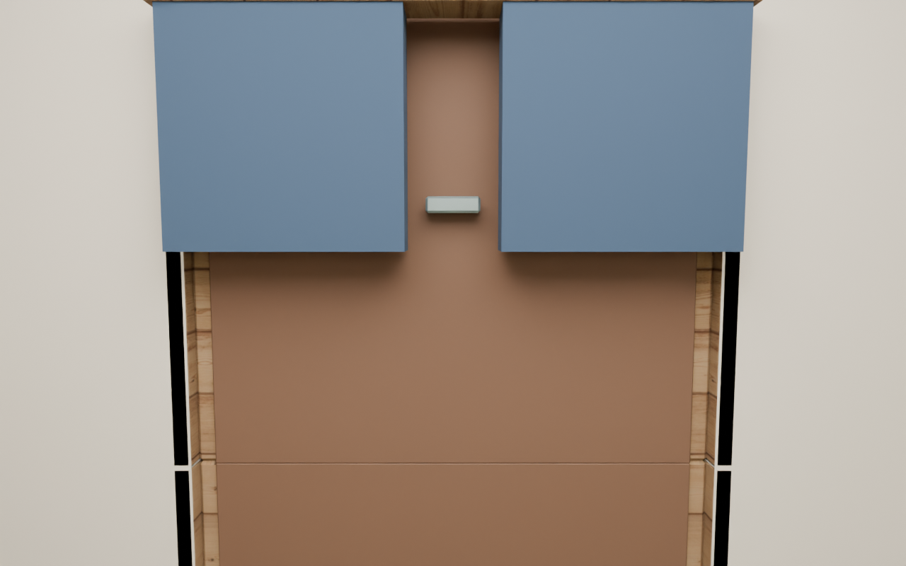
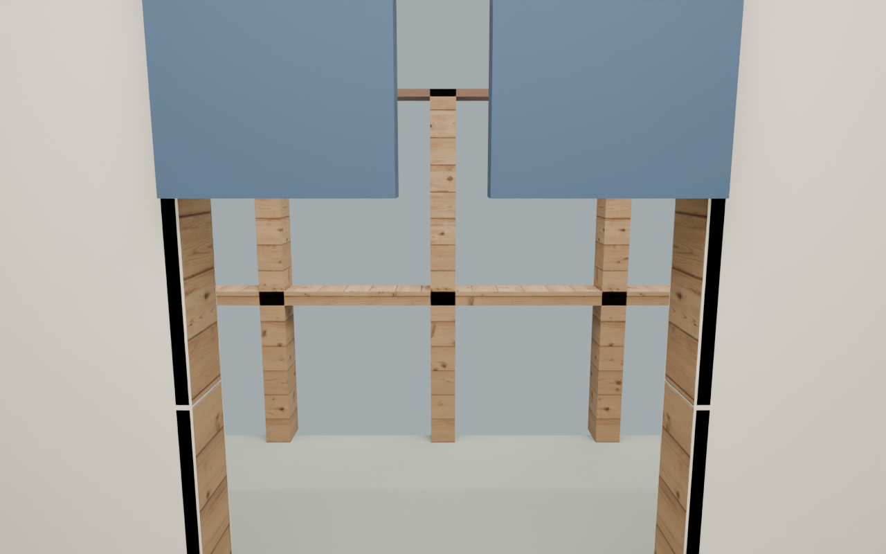
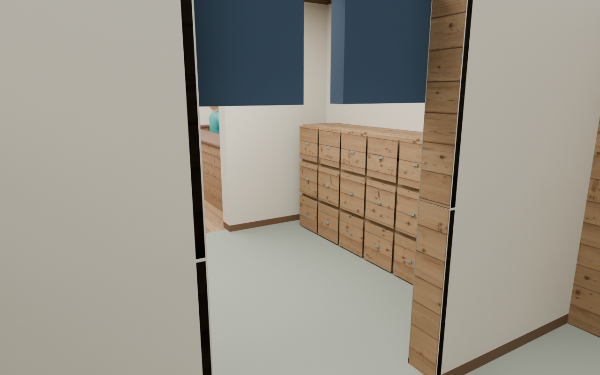

# Sento environment — growth v02

The growth-route environment reuses the reviewed world, its public source
geometry, all 17 materials and all 11 embedded images. It adds the child-area
partitions/storage, water connection, street threshold and two dynamic doors.
The export contains **9,907 architecture + 12,200 NPC triangles**, 6,931,636 bytes,
and 125 current LEVEL placements. The architecture budget is 10,000 triangles.

The actual exported GLB was reimported into Blender: finite vertices, zero
zero-area triangles, and zero intersections in 19 inspected passage interiors.
Seven offline views cover the water connection, child passage, high gate and
front door closed/open/from outside. These are inspection lighting renders;
normal-input play and game integration belong to the separate Kiro workflow.
See [measurements](quality/measurements.json), [review](quality/self-review.json)
and [metadata audit](quality/metadata-audit.json).

The source model's unrelated nodes and entire 6,288,372-byte binary prefix are
retained. Eight named architecture batches are replaced; every replacement has
an offset-independent geometry fingerprint in the [patch contract](patch/growth_v02/patch-contract.json).
The merger rejects incompatible source meshes rather than overwriting changes.
The cedar batch also loses 16 pre-existing exact zero-area triangles; remaining
positions, winding and UVs are preserved. Blender normal rounding on that batch
is at most 0.2865 degrees. Cut-polygon duplicate/collinear cleanup removed another
22 triangles from the first patch draft. Historical v01 measurements are in
[quality/v01](quality/v01/measurements.json).

`growth_kids_gate` and `growth_front_exit` are identity roots directly under
`sento_environment`. Hide the entire root when open, and only the corresponding
`_upper` child for overview. Static additions are under `environment_static`
and `environment_upper`. The front aperture is at x = 11, with no ceiling over
street. The east fence uses spaced slats within its original footprint/height;
the game's solid outer boundary remains authoritative. Runtime water is separate.

## Reproduction and integration

The editable [growth Blender scene](blend/sento_environment__growth_v02.blend)
contains the imported source context and patch objects, with all images packed.
It is not a replacement full-scene export: use the geometry-only patch merger
to preserve source NPCs, mural, materials and unrelated binary data. The original
[v01 Blender scene](blend/sento_environment__v01.blend) remains unchanged.

From a repository checkout, recover the reviewed base into a private directory:

```sh
mkdir -p .local/growth-world
git show 1418e8d:public/models/sento_environment.glb > .local/growth-world/base.glb
```

The required base SHA-256 is
`29f7ad1219bb6a6fef625c76d091bd34b73600d691de5c00e967c5ccceb7df61`.
Apply the committed geometry patch without Blender:

```sh
python3 scripts/merge-environment-patch.py \
  --base .local/growth-world/base.glb \
  --patch assets/sento_environment/patch/growth_v02/growth_environment_patch.glb \
  --contract assets/sento_environment/patch/growth_v02/patch-contract.json \
  --output .local/growth-world/reproduced.glb
```

To regenerate the patch in Blender 5.2.4 using the frozen Level contract:

```sh
Blender --background --python scripts/update-growth-environment.py -- \
  --source .local/growth-world/base.glb \
  --base-layout assets/sento_environment/patch/growth_v02/base-layout.json \
  --layout assets/sento_environment/patch/growth_v02/layout.json \
  --approved-layout-sha256 01d4ef0eda8966fe87ec3ac4551bcce129bd697040ae6dd201a0cff50e9ceba8 \
  --output-dir .local/growth-world/rebuilt --apply
```

For a different compatible environment revision, use its GLB as `--base` in the
merger. Fingerprints must pass; then remeasure the combined export and update
its manifest/ledger. This preserves unrelated NPC/mural work without assuming
the final combined asset has the same counts or hash as this revision.

The offline geometry/render check is reproducible with:

```sh
Blender --background --python scripts/review-growth-environment.py -- \
  --model .local/growth-world/reproduced.glb \
  --layout assets/sento_environment/patch/growth_v02/layout.json \
  --output .local/growth-world/review
```

## Sources and rights

The source production route was approved on 2026-11-21. No paid service was used.
Kenney Furniture Kit benches and Nature Kit rocks/shrubs are CC0. Poly Haven
Hinoki Planks by Charlotte Baglioni supplies the existing diffuse/normal/roughness
maps under CC0. Project rooms, fixtures, tile materials and generated mural retain
project-held MIT rights. Seven Meshy/Adult-derived NPCs keep their CC BY attribution.
Original files and licenses are in [public_sources](../public_sources/README.md).
Per-instance modifications and hashes remain in the measurements and ledger.
The assembled export remains a CC BY 4.0 composite, with independent original
component licenses retained. See [the distribution notice](../../public/models/sento_environment.LICENSE.txt).
No Image-to-3D generation is claimed for this local architecture patch.

## Final exported-model views














