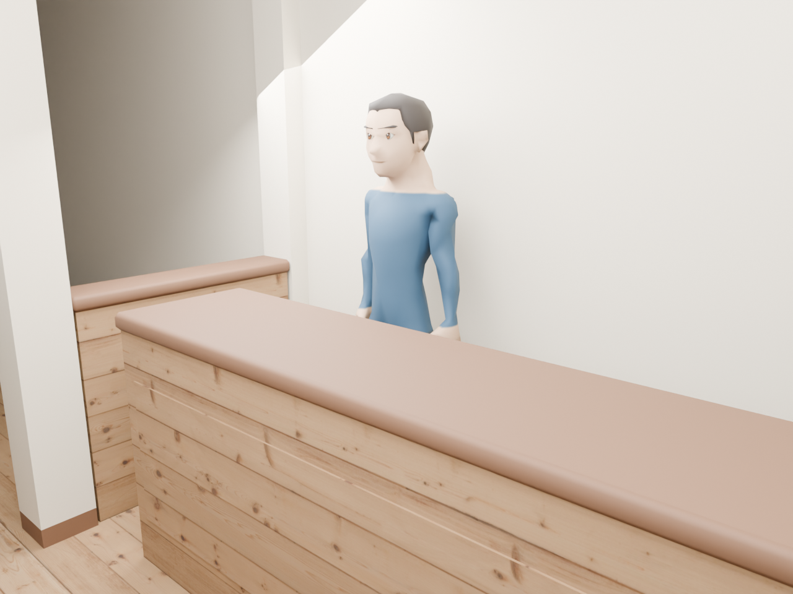
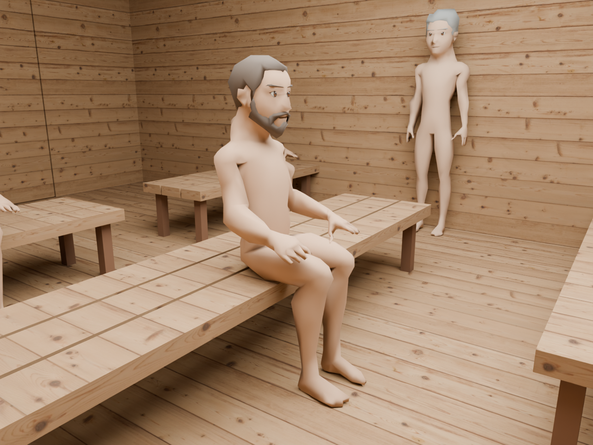
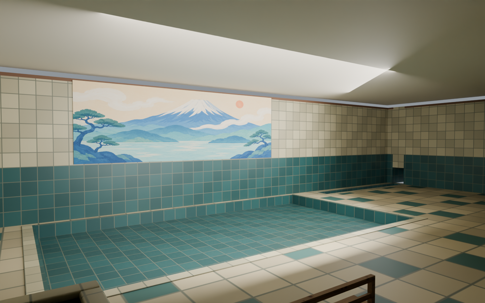

# Sento environment v03

The world keeps the existing Kenney geometry, Poly Haven materials, project
rooms/equipment and mural. Seven adult NPC placements now use three independent
Quaternius-based visitors instead of the playable father. See
[visitor sources and review](../sento_visitors/README.md).

The wall above the indoor bath displays the original panoramic Mount Fuji art.
v03 corrects its left/right orientation when seen from inside the bath. The
original full-resolution image is unchanged. Only the four inward-facing U
coordinates differ from v02; all geometry, normals, transforms, materials and
other texture coordinates are preserved. See the [mural inspection](../sento_mural/README.md).

The replacement contains **7,996 architecture triangles + 12,157 NPC triangles
= 20,153 triangles**, with 17 materials, 11 images and 5,931,660 bytes. It retains
all 64 node names, hierarchy and transforms. The NPC replacement's exact
preservation proof is retained in [v02](quality/v02/replacement-proof.json).
The subsequent [v03 byte audit](quality/v03/mural-uv-audit.json) limits the mural
change to four U values and verifies every other byte is unchanged from v02.

The seated visitors use the existing bench placement frame, with their local
geometry moved forward to put the lower legs beyond the actual board edge.
The floor remains Y=0. The source's low underside was adjusted at six vertices;
all triangles are checked against the seat-board interiors, including triangles
whose vertices lie outside the board but whose interiors cross it. This caught
a defect that sampled support rays had missed. The eleven original openings
and all five occupied benches have zero intersecting NPC triangles in the
accepted near export; far-seat checks are recorded with the visitor LODs.

[Current measurements](quality/measurements.json) distinguish raw triangle area
from the old bmesh calculation. There are 16 unchanged zero-area architecture
triangles in the old bench geometry, and zero degenerate NPC triangles. The old
bmesh method reported zero because of numerical rounding; the replacement does
not claim that those original architecture triangles were repaired.

## Sources and reconstruction

The original construction and measurements are preserved as
[v01 documentation](README-v01.md), [v01 GLB](blend/sento_environment__v01.glb),
[v01 editable source](blend/sento_environment__v01.blend), and `quality/v01/`.
The [v02 editable scene](blend/sento_environment__v02.blend),
[v02 GLB](blend/sento_environment__v02.glb), and [v02 measurements](quality/v02/measurements.json)
are preserved. The current [v03 editable scene](blend/sento_environment__v03.blend)
is a verified reimport of the corrected GLB, with all images packed. Original
detailed construction and independent visitor masters remain available separately.

Rebuild the visitor candidates first, then run:

```sh
node scripts/export-environment-layout.mjs .local/distinct-sento-npcs/layout.json
python3 scripts/replace-background-npcs.py
python3 scripts/measure-replaced-world.py
Blender --background --python-exit-code 1 --python scripts/save-replaced-world-blend.py
Blender --background --python-exit-code 1 --python scripts/render-replaced-world.py
```

These tools produce private candidates and reports. They do not replace public
assets or deploy. Their default source is the versioned v01 GLB and v01 opening
record. For a future changed layout, supply the matching world/reference inputs
and recheck the complete placement contract; do not apply the old layout hash
without verifying the changed map.

Then apply the mural correction to the audited v02 candidate:

```sh
python3 scripts/fix-fuji-mural-uv.py
Blender --background --python-exit-code 1 --python scripts/save-fuji-mural-blend.py
Blender --background --python-exit-code 1 --python scripts/render-fuji-mural.py -- --world .local/fuji-mural/sento_environment.glb
```

These commands write private candidates only. The UV correction deliberately
accepts only the preserved v02 input, preventing a second accidental flip.

The composite remains CC BY 4.0. Independent public CC0 and project MIT inputs
retain their licenses. See [distribution notice](../../public/models/sento_environment.LICENSE.txt)
and `assets/ledger.csv` for authors, actual inputs, modifications and hashes.
No paid assets were used.

## Actual export inspection

These are Blender reimport renders of the composed GLB with inspection lights.
They establish asset placement, not game-lighting or normal-input play results.
The combined final game remains subject to the shared final verification handoff.






