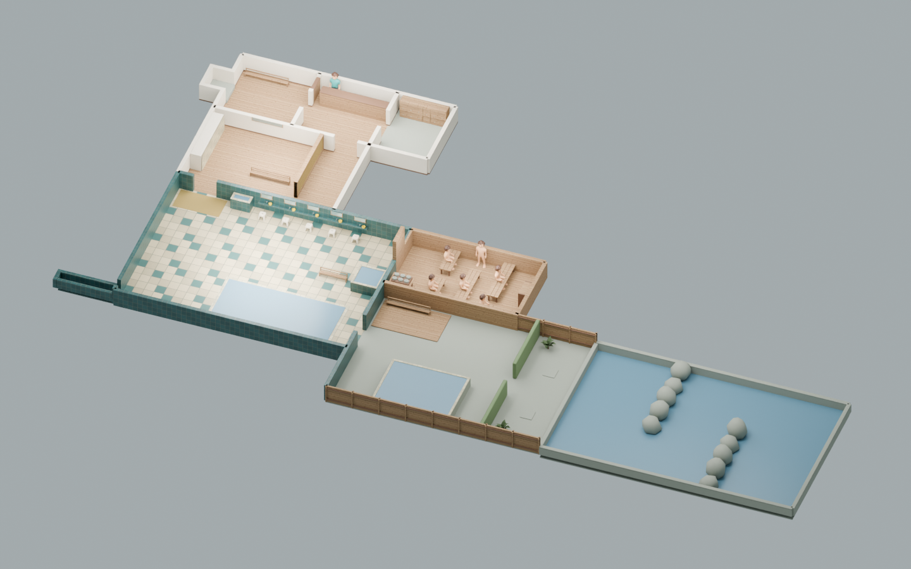
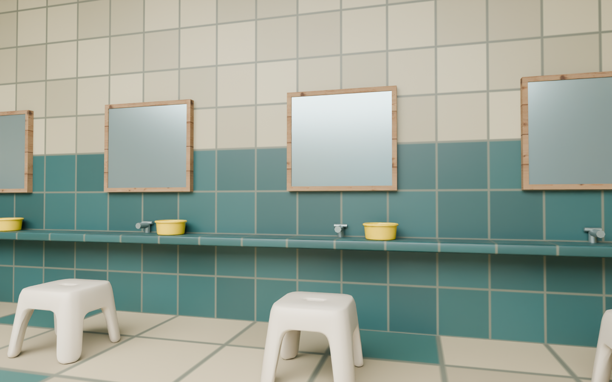
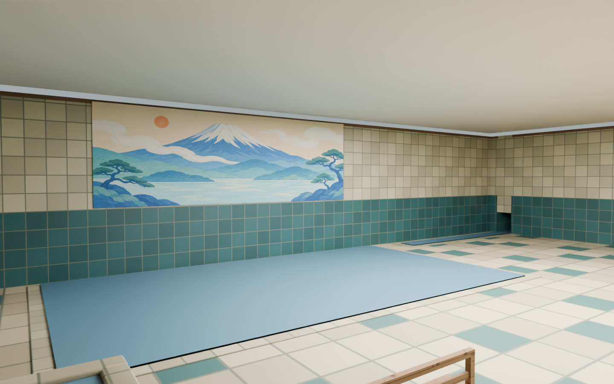
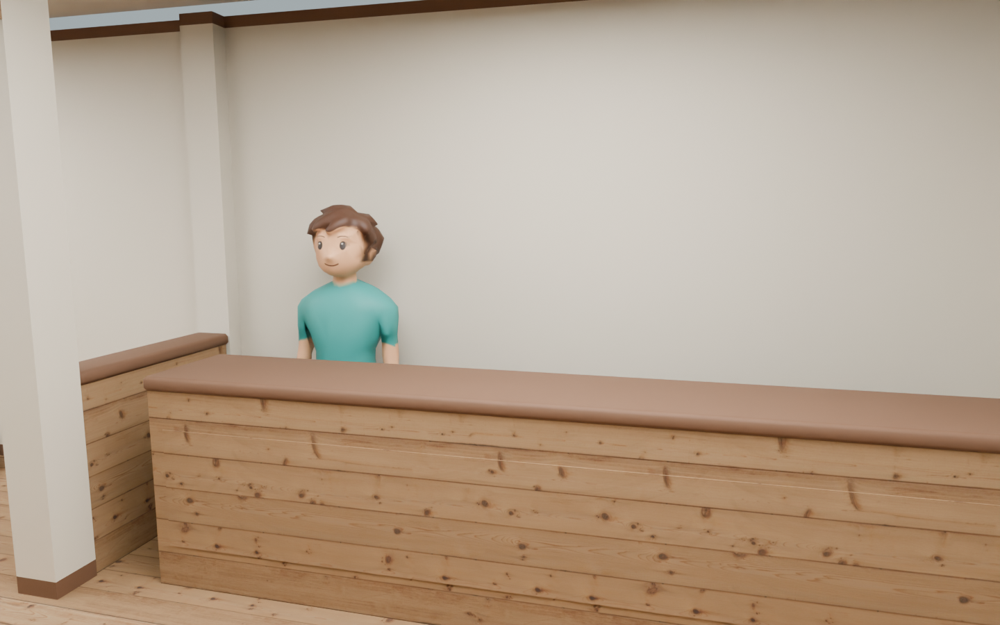
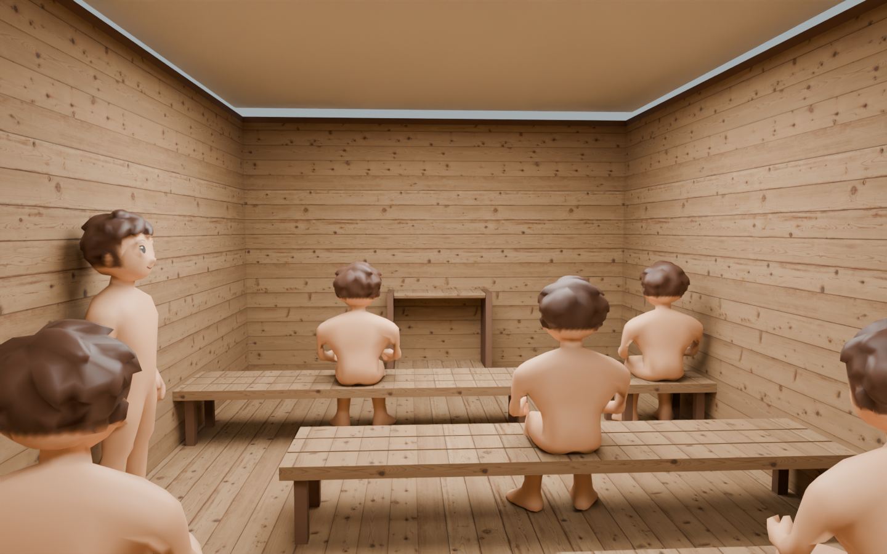
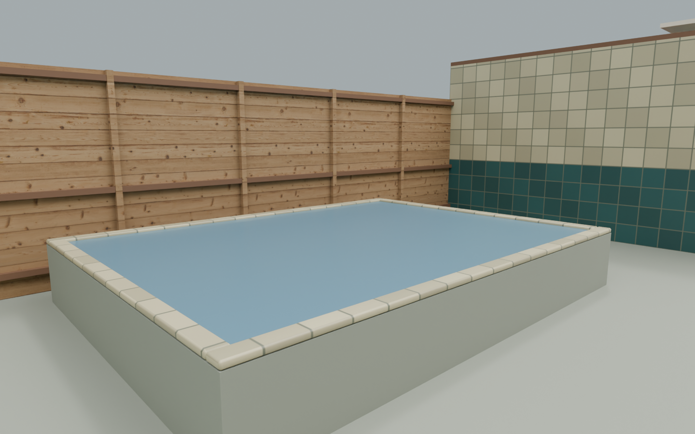
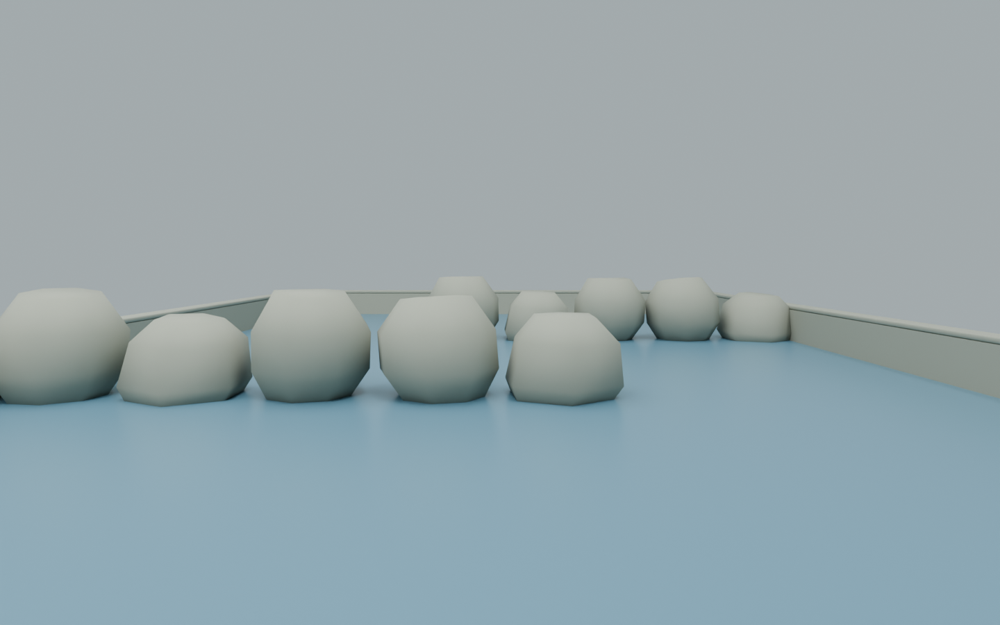

# Refreshed sento environment

The world-space environment uses free public geometry and materials, with
project-authored rooms and equipment fitted to the existing LEVEL. The user
approved this production route on 2026-11-21. No paid service was used.

- Kenney Furniture Kit bench: four placed variants.
- Kenney Nature Kit: six rock_smallH, four rock_smallI and two plant_bushDetailed instances.
- Poly Haven Hinoki Planks by Charlotte Baglioni: diffuse, normal and roughness maps.
- Original project mural, tile materials and directly authored fixtures.
- Seven Meshy/Adult-derived NPCs; their source and CC BY attribution remain intact.

Original public files, license texts and download provenance are in
[public_sources](../public_sources/README.md). Per-instance modifications and
source hashes are in [measurements](quality/measurements.json).
The assembled export is a CC BY 4.0 composite; independent CC0 and MIT inputs
retain their original licenses. See [the distribution notice](../../public/models/sento_environment.LICENSE.txt).

The editable [Blender scene](blend/sento_environment__v01.blend) packs all images.
The authoritative builder is [build-sento-environment.py](../../scripts/build-sento-environment.py).
The export has 7,996 architectural triangles plus 12,200 near-NPC triangles,
17 materials, 11 images and 6,328,656 bytes. It retains an identity root in game
world coordinates. Four named groups implement the overview, ceilings and door.

111 original placements and five additional assemblies are recorded. Triangle
clipping found no intrusion into the 11 checked hole/crowd-gap/door interiors.
The original six character/hat/washing GLBs are unchanged.

Seven actual-GLB render views received independent visual review with no
required shape defects. The pool rocks remain simple stylized forms at close
range; they do not reproduce the art reference's fine stone detail or dense
planting. The renders add the separate runtime water and washing models for
context, and are not screenshots of game lighting or evidence of normal play.
See [self review](quality/self-review.json) and [metadata audit](quality/metadata-audit.json).

## Fixed export views

