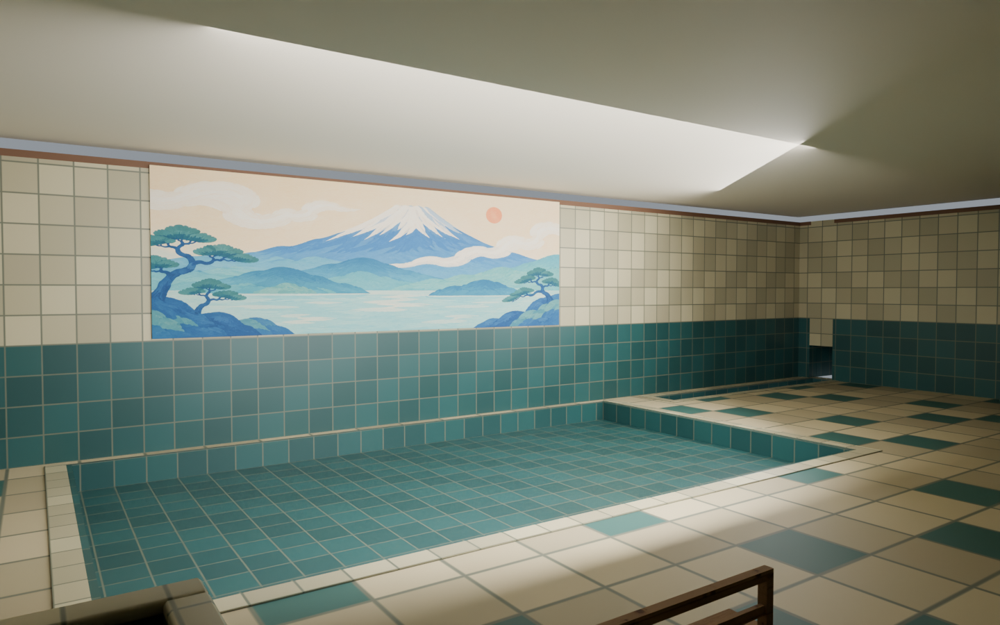
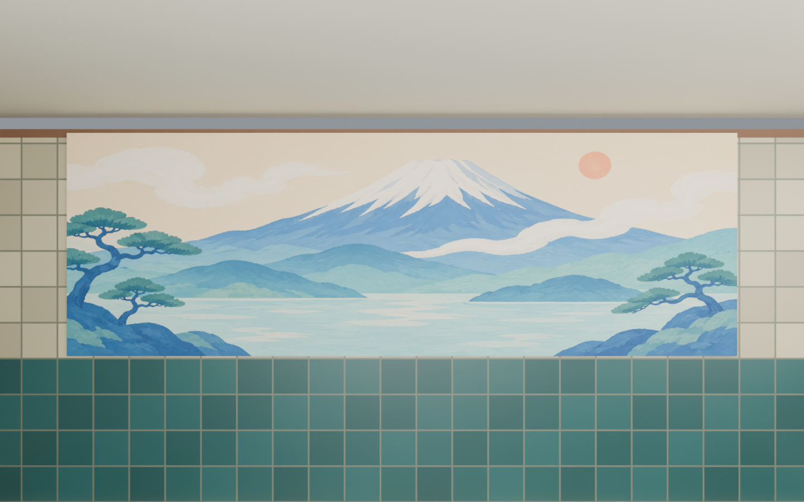

# Mount Fuji on the bath wall

The indoor bath has a panoramic Mount Fuji painting on its back wall, above the
turquoise tiles. The original [2172 × 724 artwork](ref/sento_mural__v01.png) is
embedded without resizing or recompression. The 4.65 × 1.55 m panel preserves
its 3:1 aspect ratio. It sits just inside the Z=8.9 m wall; its bath-facing
surface is at Z=8.882 m and Y=1.02–2.57 m.

The earlier world already included this painting, but its bath-facing texture
was horizontally reflected. Environment v03 corrects the four U coordinates
on that face. The sun now appears on the right and the large pine on the left,
matching the original artwork. The patch changes 12 bytes within four float32
values. Every other GLB byte, including all geometry, images, materials, node
transforms and other UVs, is preserved from v02.

The mural remains part of `environment_upper`: normal views display it with
the full bath wall, and Overview hides that wall for the existing map cutaway.
No floating picture or new obstacle is introduced in Overview.

## Actual export inspection

These images reimport the actual accepted GLB in Blender with inspection
lights. No geometry, material or visibility is changed. They are asset
inspection views; the game's water surface and game lighting are separate.
They do not constitute normal-input play verification.

## Reproduction and evidence

The [world reconstruction instructions](../sento_environment/README.md) preserve
v01, the independent-NPC v02 and the current v03 editable source. Run
`python3 scripts/fix-fuji-mural-uv.py` to produce the corrected candidate from
the archived v02 GLB. The script pins the input checksum and rejects an already
corrected or changed input. Output stays in `.local/fuji-mural/`.

- Preserved Fuji-correction v03 GLB: `assets/sento_environment/blend/sento_environment__v03.glb`, SHA-256
  `6ac2a9e99b4d068118ad30ddd01c9feda9ec273ade594aa157a39010d21b4c98`.
- [Byte-preservation audit](../sento_environment/quality/v03/mural-uv-audit.json):
  only the four inward-facing U values change; the original art is unchanged.
- [Editable-source audit](../sento_environment/quality/v03/editable-source-audit.json):
  64 objects and 11 packed images; hierarchy, geometry, UVs and image pixels
  remain identical after saving and reopening. Scoped private-path audit: zero matches.
- [Render record](../sento_environment/quality/v03/render-report.json): exact
  GLB and PNG checksums, cameras and inspection scope.
- Producer regressions: **3 passed**. Actual export and visibility tests:
  **6 passed / 2 files**. The new orientation check failed against v02 before
  the fix and passes against v03.
- `npm run build -- --base=/sento-duck-explorer/`: passed, including typecheck;
  the existing large JavaScript chunk warning remains.
- Independent visual and byte-level review: **zero required findings**.

Geometry counts, draw budget and all character/NPC data are unchanged; their
prior v02 results are retained as prior results, not new full-suite or play runs.
Normal-input bath viewing and game lighting remain on the shared final-check
list. Main/production integration is held while the separate growth/exit work
is reconciled; this record describes the isolated asset branch.

Original art generation and rights are in [reference provenance](ref/README.md).
The later [v04 world](../sento_environment/README.md) changes one visitor's
appearance while preserving this corrected mural and all of its image/UV data.
The project-held original image rights are MIT to the extent permitted by law.
World-composite inspection renders retain CC BY 4.0 with the independent source
licenses and credits described in [the world notice](../../public/models/sento_environment.LICENSE.txt).
No paid asset or service was added.
