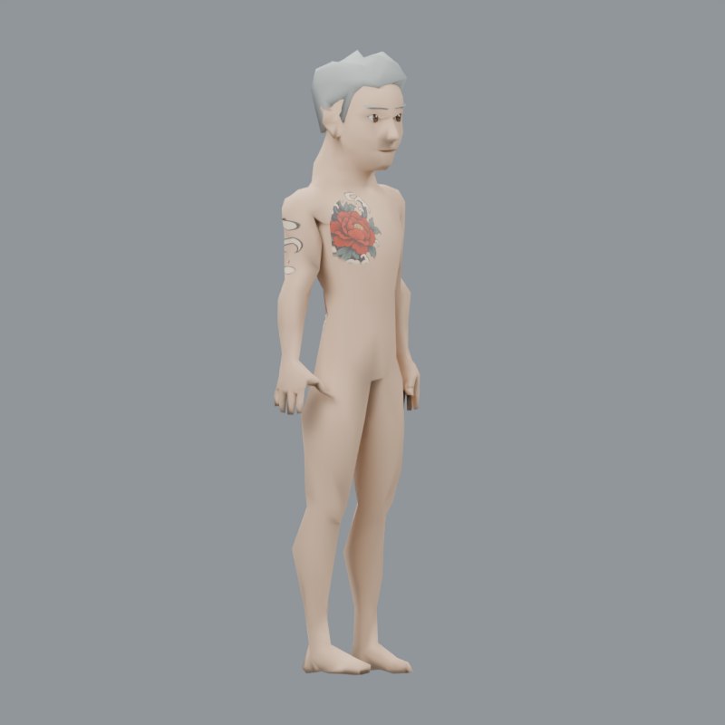
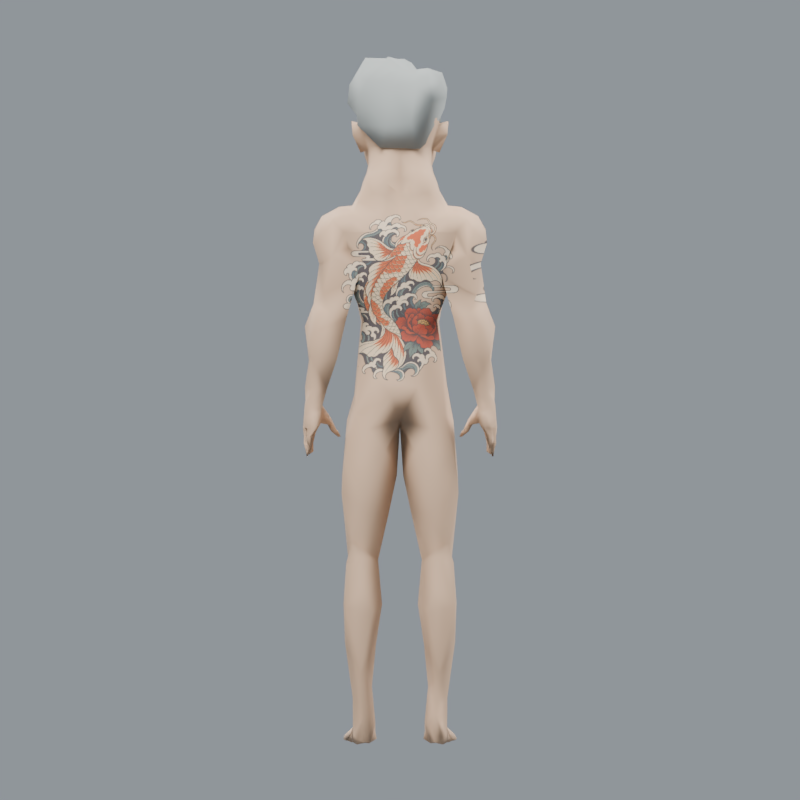
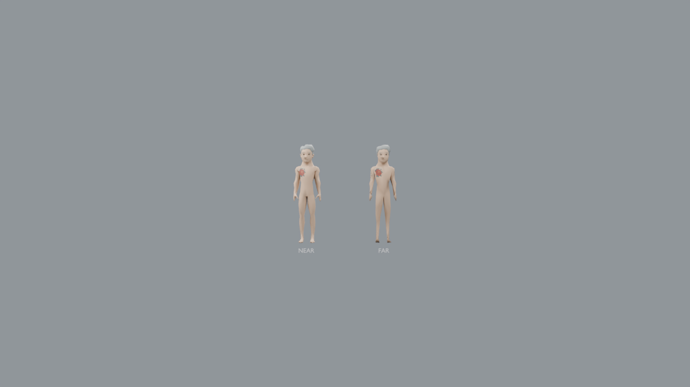

# Tattooed sento visitor

This fourth visitor appearance uses the existing independent Quaternius standing
adult, with original Japanese irezumi-inspired koi, waves and peony artwork.
The back carries the main koi design; the upper chest and one arm carry smaller
motifs. The face, hands and lower body remain unmarked. The ordinary three
visitor models are preserved. In the current world, the tattooed version uses
the existing standing `npc_slot_2`, with the same position, pose and footprint.

## Source and material work

The parent near and far GLBs are `npc_bath_standing.glb` and
`npc_bath_standing_lod_far.glb`. Their geometry comes from the free Quaternius
Universal Base Characters Standard pack, under CC0. Project modifications are
MIT. No playable-father geometry, textures or UVs are used. See the
[parent production record](../README.md) and [attribution](../ATTRIBUTION.md).

The original tattoo PNG was generated with the built-in OpenAI image tool from
a text-only prompt. Its source pixels, alpha and provenance are preserved in
[ref/](ref/README.md). Blender material nodes compose the ink over the existing
skin color into one 1024² runtime atlas. The original 512² atlas occupies a
native-resolution quadrant, retaining the eye's 240² pixel area. The image art
and the public-source geometry have distinct provenance; there was no new
Image-to-3D generation or paid asset purchase.

The models retain the parent's exact oriented position/normal triangle samples:
**1,594 triangles near, 594 far**. Vertices may split at new UV seams without
altering the surface, normals, pose or bounds. Both distance versions use the
same tattoo atlas. The distant version is intended only beyond the existing
6 m camera-to-center switch or in Overview. Enlarged distant meshes remain
visibly faceted, as documented for the parent distance models.

## Accepted export inspection







These are reimports of the actual GLBs, with inspection lighting. First drafts
were rejected for stretched rib/arm stripes, stray neck fragments and a peony
cut at a distant-model triangle edge. Torso-only back projection, a cylindrical
arm chart, a smaller chest motif and clean-skin margins resolve those defects.
Both left/right views, the back, face and intended-distance comparisons were
reviewed. The 6.1 m views use 55° vertical FOV at 1280 × 720 without cropping.

| Export | Triangles | Vertices | Bytes |
| --- | ---: | ---: | ---: |
| Near | 1,594 | 971 | 398,704 |
| Far | 594 | 401 | 374,692 |

Exact model, source, atlas, editable and render SHA-256 values are in
[measurements.json](quality/measurements.json). The 512² source region and
240² eye region retain decoded pixels exactly (maximum channel difference 0).
Both models use the same 1024² atlas. The packed editable scene reopens with
identical geometry, UVs and image pixels; its scoped private-path audit found
zero matches. The unchanged source PNG's provenance chunk remains intact.

The world placement is checked in [environment v04](../../sento_environment/README.md).
Its triangles remain 20,153, with 11 clear route openings and five clear occupied
bench interiors. The 19 registered runtime GLBs total 9,324,440 bytes, under
the 12 MB initial-download limit. The combined scene's existing finite-grid
60,000-triangle limit passes, including outfits and temporary transparency.

Relevant actual-asset, LOD, environment and scene-budget tests: **13 passed in
5 files**. Four dedicated composition regressions passed; the root reused the
producer's result. Typecheck and Pages-base build passed, with the existing
large JavaScript chunk warning. Independent visual, code and world-preservation
review has **zero required findings**. These are not normal-input play results.
Game lighting and appearance belong to the single combined final verification.
Main/publication remains held for the parallel growth/exit integration.

## Reconstruction

```sh
Blender --background --python-exit-code 1 --python scripts/build-tattooed-sento-visitor.py
python3 scripts/replace-tattooed-visitor.py
Blender --background --python-exit-code 1 --python scripts/save-tattooed-world-blend.py
Blender --background --python-exit-code 1 --python scripts/render-replaced-world.py -- --tattoo --world .local/tattooed-visitor/world/sento_environment.glb --output-dir .local/tattooed-visitor/world/renders
```

These commands write private candidates. They do not activate models or deploy.
The dedicated world patch accepts the archived Fuji-corrected v03 world and
replaces only slot2 appearance/provenance. It verifies every other visitor,
architectural mesh, original image and corrected Fuji mural remains intact.
The previous all-role NPC producer must not be run as the tattoo integration.

Original Quaternius files and the ordinary visitors remain available unchanged.
The tattooed model modifications, original art and standalone inspection images
are offered under MIT to the extent of project-held rights, with CC0 source
credits retained. World-placement images retain the world's CC BY 4.0 composite
notice and independent component licenses. See `assets/ledger.csv` for exact
files and checksums.
