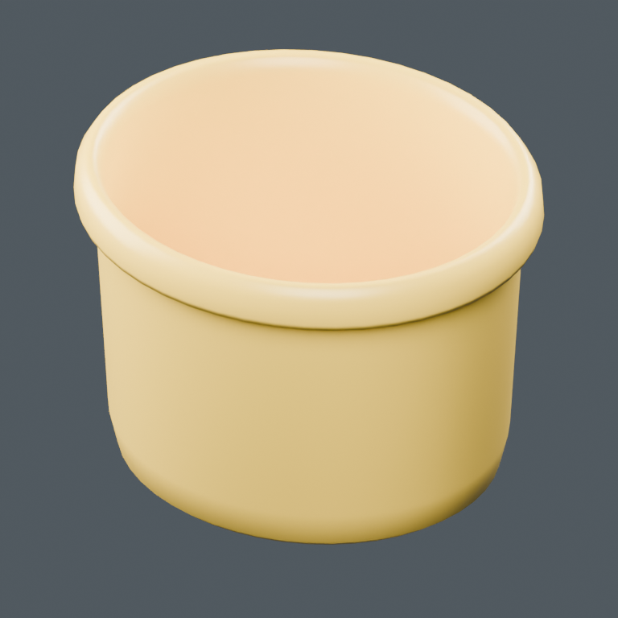
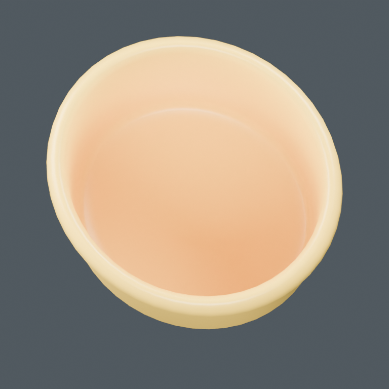
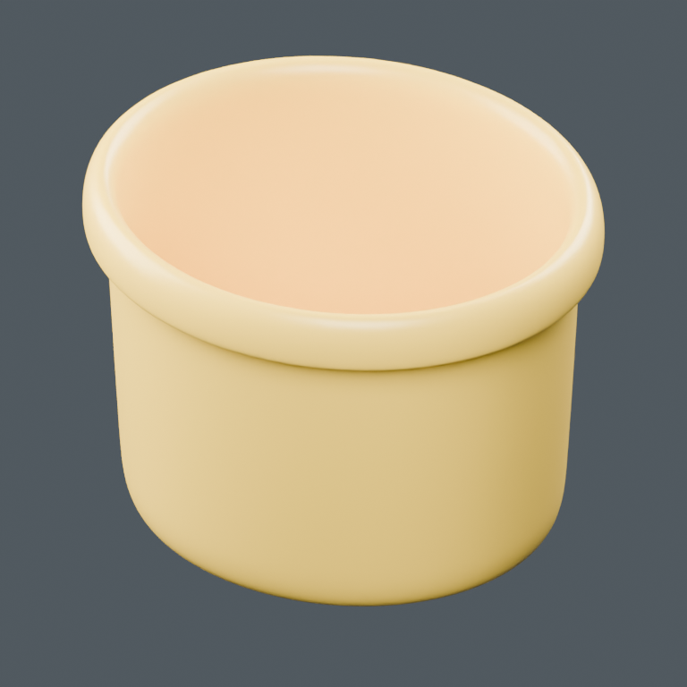

# Yellow wash basin

Produced on 2026-11-21 through the required **reference image → Meshy Image to 3D → Blender adjustment → GLB** pipeline. This is a measured runtime asset candidate; in-game appearance, independent review and the final normal-input playthrough remain separate checks.

| Stage | File | State |
| --- | --- | --- |
| Reference | `ref/wash_basin__ref_threequarter_v01.png` | Original AI-generated single-object image; provenance in `ref/README.md` |
| Image to 3D | `gen/wash_basin__meshy6lite_raw_v01.glb` | Unmodified Meshy 6 Lite download |
| Blender | `blend/wash_basin__v01.blend` | Fitted retopology plus a hidden normalized source object |
| Runtime export | `../../public/models/wash_basin.glb` | Reimported, measured and rendered |
| Measurements | `blend/wash_basin__measurements_v01.json` | Counts, bounds, cavity depth, measured profile and source fitting distances |

## Production and shape correction

Codex uploaded the single-object reference through the native file picker and used **Meshy Free / Meshy 6 Lite / Texture off**, with CC BY 4.0 displayed. Generation consumed 10 free credits. The resulting untextured GLB was downloaded without a paid subscription. It contains **97,848 triangles / 48,926 vertices** and no material or texture. The original file is retained byte for byte.

The user chose free Blender correction after reporting insufficient model fidelity. A first reduction to 790 triangles visibly flattened the rim and introduced vertical shading ridges, so it was rejected. A 1,990-triangle reduction with transferred source normals improved shading but left a wavy rim. Those exploratory outputs are not the runtime asset.

The final model is **retopologized from actual generated geometry**, not replaced with an unrelated primitive. In Blender 5.2.4 LTS, the source was normalized to the existing runtime envelope and lightly smoothed to remove tiny generation noise. Twelve radial planes were intersected with that mesh. Their real contour paths were resampled by arc length and averaged, keeping the rolled rim and its underside return, wall taper, inner wall and bottom. Adaptive contour reduction selected 20 rings; 48 evenly spaced sectors produce a regular, smooth silhouette without the earlier angular dents. The central underside and inner floor were flattened. The exact measured contour points are in the measurement JSON. The hidden normalized source in the `.blend` and the untouched `gen/` file retain the input evidence.

The final export has **1,920 triangles / 962 vertices**, one mesh, one warm-yellow satin-plastic material, no textures and no external resource URI. The GLB is **36,176 bytes**. This requires the revised provisional 2,000-triangle basin budget; the earlier 800-triangle target did not preserve the requested surface quality. It does not require payment.

The runtime envelope is **0.20 × 0.14 × 0.18 m (X × Y × Z)**, +Y up, +Z forward, with a bottom-center origin and no sockets. The basin is deliberately fitted to the existing oval decor envelope; no collision or placement rule is changed. This fitting makes the source taller than its original generated proportions, as required by the existing game envelope.

## Shape verification

The `.blend` reopened with the same counts and bounds. The actual exported GLB was reimported and rendered from the front, a three-quarter angle, above the interior and below the base. The open interior, continuous rim and closed underside remain visible. The regular circumference removes the earlier waves and vertical ridges. A normalized raw comparison uses the same camera and a display-only yellow material; it does not modify the original download.

| Check | Normalized raw | Reimported final |
| --- | ---: | ---: |
| Center interior floor height | 8.742 mm | 8.783 mm |
| Cavity depth below the top | 131.258 mm | 131.217 mm |
| Mesh volume | 0.000511186 m³ | 0.000509807 m³ |
| Nonmanifold edges | 0 | 0 |

The final mesh volume differs by −0.27%. Final-vertex distances to the normalized raw surface are **0.307 mm median, 0.652 mm at the 95th percentile and 1.395 mm maximum**. These are sampled vertex-to-surface distances, not a guarantee of an exact surface match. All exported positions are finite. Counts, dimensions and the cavity are measured after export rather than inferred from the working scene.

Limited scans of the raw GLB, `.blend` and final GLB found no private user path, private temporary path, personal-mail marker or common GitHub-token prefix. The GLB contains no camera or light. These are scoped checks, not an exhaustive metadata or rights audit. The asset renders are not gameplay validation or user acceptance.

## Reproduction and license

Run `Blender --background --python scripts/finish-wash-basin.py` from the repository root using Blender 5.2.4 LTS. The script imports the preserved generated GLB, fits the measured contours, saves the editable scene, exports the runtime GLB, reimports it and renders the inspection views. The original raw file and reference image are not overwritten.

The generated model, adjusted Blender scene, GLB and derived previews are **CC BY 4.0**, with attribution to **Meshy** and an indication of the Blender modifications. See [ATTRIBUTION.md](ATTRIBUTION.md) and `public/models/wash_basin.LICENSE.txt`. The reference image has its own MIT release of project-held rights. The code repository’s MIT license does not replace the asset license.
